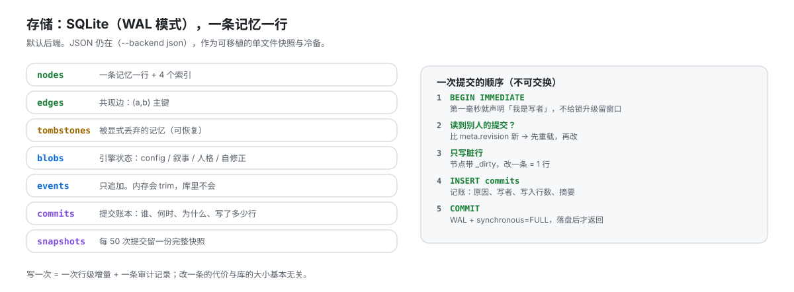
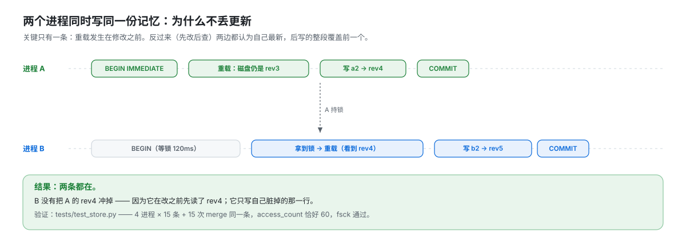

# memory-palace

**一个会遗忘的记忆库。** 不是把所有文本塞进向量库，而是给每条记忆一个寿命、一个价值、
一个「什么时候该忘」的判决；想不起来的时候，它会说「我没有」，而不是端几条最像的上来。

零第三方依赖（Python 标准库）· 默认 SQLite/WAL · 单机多进程可写 · MCP / HTTP / CLI 三面接入

[](https://github.com/Y5H1ggs/memory-palace/actions/workflows/ci.yml)
[](LICENSE)
[](pyproject.toml)
[](pyproject.toml)


> 给读这个仓库的模型：机器可读的现状在 **[llms.txt](llms.txt)**；要整份交给评审模型，用
> **[llms-full.txt](llms-full.txt)**（约 50 KB，含文件清单与全部测试用例名）。
> `docs/` 里带「时效声明」的两篇是历史文档，描述的是 0.5.x / 0.9，不是现状。

---

## 先看它怎么用（30 秒）

```bash
git clone https://github.com/Y5H1ggs/memory-palace.git && cd memory-palace
python -m memory_palace.demo      # 六幕演示，20 条断言，约 1 秒
```

demo 依次演：写入与检索、存储行级写、4 进程并发写、嵌入自检、遗忘与沉淀、106 领域评测。
每一幕最后都有一句「这一步的重点是什么」，不用先读代码。

当库用：

```python
from memory_palace import MemoryPalace

palace = MemoryPalace(path="~/.memory-palace/store.sqlite")   # 默认 SQLite（WAL）

palace.remember("rule:test", "说「完成」之前先跑一遍自测", tier="core", pinned=True)
palace.remember("lesson:cp1252", "CI 在 Windows 上因为控制台编码炸了", tags=("复盘", "教训"))

palace.recall(query="控制台编码导致 CI 失败")   # → 命中 lesson:cp1252
palace.recall(query="量子计算的退相干时间")      # → 弃答（库里没有这个）
```

当 agent 的记忆后端用（CLI，agent 走这条）：

```bash
memory-palace context --query "怎么避免线上事故" --budget 800   # 会话开始：注入一块
memory-palace remember "周五不发布，出事没人修" --tags 流程,教训
memory-palace outcome m:719af3d5 contradicted                  # 用户纠正了你
memory-palace cycle                                            # 会话结束：代谢一轮
```

接宿主的三种方式（MCP / HTTP / CLI 语义一致）：见 [docs/INTEGRATIONS.md](docs/INTEGRATIONS.md)。

---

## 它解决的一个具体问题

大多数「AI 记忆」做的事是：**存下来 + 相似度检索**。于是三个月后你问一件事，它会把
所有沾边的都端上来，包括早就作废的结论。

这里的区别只有三句话：

| | 向量库 / 普通 RAG | 这里 |
|---|---|---|
| 很久没被想起的事 | 一直在，除非你删 | 按强度和价值衰减，**过期就忘** |
| 十条碎片什么时候变一条结论 | 不会 | 结构 + 语义双通道结晶，**单向门** |
| 没记过的东西被问到 | 硬凑最像的几条 | **弃答**，只保留钉死的硬规则 |

代价也要说：它比向量库慢一点（要算生命周期），也不解决「同义改写」——
后者靠接真模型，见下面「嵌入模型」一节。


`run_cycle()` 的次序是设计的一部分：沉淀早于遗忘（否则要结晶的碎片先被扫走）、
抓取早于遗忘（否则想留的留不下）、自述晚于遗忘（否则会讲到已经不在的东西）。

---

## 三个概念，够用了

**1. 权重是「锚点 + 时间」的纯函数，不是余额。**
所以 GC 跑一次和跑一百次，期末逐位相同；不会因为调度频率改变而忘得更快。

**2. 情绪乘在稳定性上，不加在权重上。**
加权重只是「更亮」；乘稳定性改变的是衰减速度 —— 这才是「怎么抓都抓不住的东西偏偏最难忘」。
代价照收：唤醒越高，编码越可能被改写。

**3. 叙事是投影，不是节点。**
图里不会多出一个「我」。自述是读图的方式，删掉它不影响任何一条记忆。

---

## 存储与并发



一条记忆一行。改一条只写一行，不再整库重写。


| | JSON（0.9.x） | SQLite（现在） |
|---|---|---|
| 单次 `remember` p50 / p95 | 28.2 / 47.7 ms | **1.2 / 2.1 ms** |
| 改一条 | 重写全库 | **只写 1 行** |
| 多进程写 | 覆盖丢更新 | `BEGIN IMMEDIATE` + 变更前重载 |
| 读库（1000 条） | 44.9 ms | 45.7 ms（基本持平） |
| 磁盘（1000 条） | 2.0 MB | 4.5 MB（行 + 4 个索引） |



四条机制缺一不可：`BEGIN IMMEDIATE` 先声明写意图、**改之前先重载**、只写自己脏的行、冲突记账。
读路径也会 `refresh()`，否则长驻的 MCP 进程永远停在「自己上次写完那一刻」。

实测：4 进程 × 6 条独立写入 + 共用一条 merge，一条不少、`access_count` 等于调用次数、`fsck` 通过。
**边界**：SQLite 单写者，写热点会排队；要更高写吞吐请换服务端数据库，这个项目不在上面加锁。

运维命令：`fsck` / `journal` / `lock` / `export` / `import` / `stats`。
机制与代价详见 [docs/STORAGE.md](docs/STORAGE.md)。

---

## 嵌入模型：可以换成真的神经语言模型

内置的 `HashingEmbedder` **不是神经模型**：有符号特征哈希 + 字符 n-gram，零依赖、跨进程确定，
能补字面变形，但读不懂「止盈」和「落袋为安」。

要语义跳转就换真模型，五种 provider 走同一个 `SemanticIndex` —— 检索、聚类、去重、弃答**一起换**：

| provider | 接什么 | 依赖 |
|---|---|---|
| `hashing` | 内置哈希，512 维 | 无 |
| `ollama` | 本机 Ollama（新版 `/api/embed`，旧版自动回退） | 无 |
| `http` / `openai` | 任何 OpenAI 兼容 `/v1/embeddings`（vLLM / TEI / LM Studio / 云） | 无 |
| `st` | 本地 sentence-transformers 加载 HF 模型 | `pip install sentence-transformers` |

```bash
ollama pull bge-m3
memory-palace config --set embedding_provider=ollama
memory-palace config --set embedding_model=bge-m3
memory-palace embed --check      # 同义改写 vs 无关句，分不开就判不可用
```

推荐：`bge-small-zh-v1.5`(512) 最快、`bge-base-zh-v1.5`(768) 平衡、`bge-large-zh-v1.5`(1024)、
`bge-m3`(1024, 8192 上下文)、`m3e-base`(768)、`Qwen3-Embedding-0.6B`(1024, 32k, 可自定义维度)、
`jina-embeddings-v3`(1024)。维度以 `embed --check` 实测为准。

**为什么必须自检**：只看维度没有意义 —— 一个把什么都编码成同方向的模型也有 1024 维。
换模型后余弦分布会变，阈值要重扫：`memory-palace calibrate`。

---

## 评测：106 个领域，先打印最差的


**600 条记忆 / 590 条查询**（474 可答 + 116 不可答），106 个领域：做饭、养猫、牙科、签证、
数据库、谈判、税务、摄影…… 每个领域 6 条记忆 + 4 条查询，其中一条是**从别的领域借来的问题**，
用来测「会不会拿这个领域的记忆去硬凑另一个领域的问题」。

```bash
memory-palace eval              # 汇总 + 最差 5 个领域
memory-palace eval --verbose    # 逐个领域
memory-palace eval --list       # 106 个领域都是什么
memory-palace calibrate         # 在全部领域上重扫阈值，给平台区间
```

当前结果（词法通道，k=5）：

| 指标 | 数值 | 覆盖 |
|---|---|---|
| recall@5 | **0.899**（中位数 1.000） | 106 个领域 |
| MRR | 0.817 | 106 个领域 |
| 弃答 F1 | 0.757 | 106 个领域 |
| 去重 F1 | 0.944 | 6 个深标注领域 |
| 沉淀 F1 | 0.000（默认阈值 0.50） | 6 个深标注领域 |

**覆盖数必须分开报**：106 个领域里只有 6 个标了去重对与沉淀簇 —— 把 6 个的数字说成
「106 个领域的去重 F1」是另一种撒谎。

两处不好看，但留着：

- **最差的是 `zh-language`（0.25）与几个 0.50 的领域**：问「猫不爱喝水怎么办」，
  正文写的是「缺水 / 饮水」，一个字都不一样 —— 词法通道救不了，只有真模型能救。
- **沉淀 F1 = 0.000**：这 6 套数据每条记忆标签各不相同，0.50 的门槛一条簇都出不来；
  扫描显示 0.25~0.30 才合适。默认值是给「标签共享」的语料调的。

---

## 证据

```bash
python -m pytest tests -q          # 120 项：契约 / 并发 / 崩溃 / 评测 / 护栏 / 文档
python -m memory_palace.demo       # 六幕演示，20 条断言
python tools/greenlight_audit.py   # 绿灯审计：31 个变异，故意弄坏实现看断言会不会红
python -m memory_palace.bench 1000 # 性能（含单次写入 p50/p95）
```

`31 条突变审计` 是这里最有价值的部分：衰减带副作用、跳过校验和、锁不生效、
LLM 白名单失效、忽略护栏、相似度丢掉余弦通道…… 断言必须变红。
这套审计抓到过「测试全绿但功能已废」的改动，也抓到过一条自己写错的测试。

---

## 仍然不适用

- 不是**专用向量数据库**的替代品：没有 ANN、没有分片，1e4 条以内够用。
- 不承诺**多写者高吞吐**：SQLite 单写者，写热点排队。
- 不是**分布式**记忆：单机文件，WAL 需要本地盘。
- 标注是**一个人标的**：能验证流程与量级，替代不了你自己的语料（`calibrate` 就是给你换语料用的）。

---

## 版本与结构

当前 `0.12.0`。`0.x` 期间 API 可能变。升到 `1.0.0` 的条件见 [CHANGELOG](CHANGELOG.md)：
外部使用者 ≥ 1（未达）· CI 三平台 ✅ · 公开评测集与基线数字 ✅ · 跨进程写锁 ✅。

```
memory_palace/
  core / affect / logic / consolidation / value / narrative / persona
  memory_model / reflection / llm / selfcorrect / style / tree / scope
  semantics / embedding / lexicon / pragmatics
  store / sqlite_store / journal / locking        ← 持久化与并发
  evaluation / evaluation_domains                 ← 106 领域评测
  palace / cli / mcp_server / http_api / render / bench / demo
examples/  quickstart · showcase · make_images · make_diagrams · custom_encoder
docs/      ARCHITECTURE · STORAGE · INTEGRATIONS · AGENT_INTEGRATION
           LEXICON · PRAGMATICS · COMPETITIVE_ANALYSIS · CRITIQUE_RESPONSE
           REVIEW_2026-11-14_QWEN · REVIEW_2026-11-14_QWEN_MICRO
llms.txt / llms-full.txt   机器可读的现状（后者含文件清单与测试清单）
tests/     temporal · scope · extensions · lexicon · pragmatics · audit
           store · locking · embedding · eval · llm · guardrails · cli · integrations · docs
tools/     greenlight_audit.py（变异测试）· make_review_bundle.py（评审包）
dsh/       DeepSeek Harness 插件
```

## License

MIT © 2026 Howard
