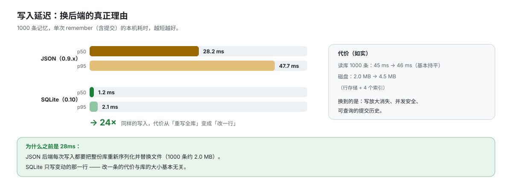
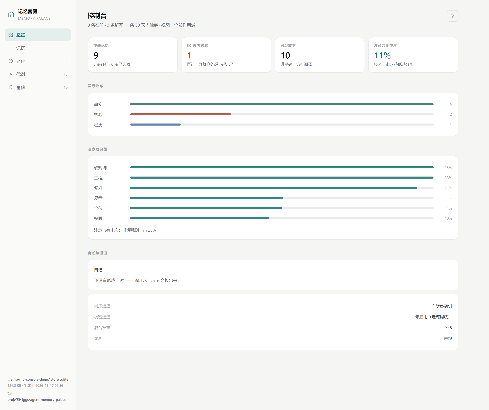

# Memory Palace · 给 AI Agent 的长期记忆库

**会遗忘、会弃答、零依赖。** 不是把所有文本塞进向量库，而是给每条记忆一个寿命、一个价值、
一个「什么时候该忘」的判决；想不起来的时候，它会说「我没有」，而不是端几条最像的上来。

> **Long-term memory for LLM agents** — a dependency-free memory lifecycle with a forgetting
> curve, abstention, and a SQLite/WAL backend. Cross-session memory for Claude Code / Cursor /
> any MCP client. No vector database, no embedding service, no `pip install` required.

零第三方依赖（Python 标准库）· 默认 SQLite/WAL · 单机多进程可写 · MCP / HTTP / CLI 三面接入

[](https://github.com/Y5H1ggs/agent-memory-palace/actions/workflows/ci.yml)
[](LICENSE)
[](pyproject.toml)
[](pyproject.toml)

**关键词**：AI Agent 记忆 · LLM 长期记忆 · 跨会话记忆 · MCP 记忆服务器 · 遗忘曲线 ·
向量库替代 · SQLite 记忆库 · 零依赖 · agent memory · long-term memory · memory MCP server


> 给读这个仓库的模型：机器可读的现状在 **[llms.txt](llms.txt)**；要整份交给评审模型，用
> **[llms-full.txt](llms-full.txt)**（约 41 KB，含文件清单与全部测试用例名）。
> `docs/` 里带「时效声明」的两篇是历史文档，描述的是 0.5.x / 0.9，不是现状。

---

## 先看它怎么用（30 秒）

```bash
git clone https://github.com/Y5H1ggs/agent-memory-palace.git && cd agent-memory-palace
python -m memory_palace.demo      # 六幕演示，20 条断言，约 1 秒
```

demo 依次演：写入与检索、存储行级写、4 进程并发写、嵌入自检、遗忘与沉淀、106 领域评测。
每一幕最后都有一句「这一步的重点是什么」，不用先读代码。

想看图形界面：

```bash
python -m memory_palace.cli console --out console.html   # 单文件控制台，双击即开
```

当库用：

```python
from memory_palace import MemoryPalace

palace = MemoryPalace(path="~/.memory-palace/store.sqlite")   # 默认 SQLite（WAL）

palace.remember("rule:test", "说「完成」之前先跑一遍自测", tier="core", pinned=True)
palace.remember("lesson:cp1252", "CI 在 Windows 上因为控制台编码炸了", tags=("复盘", "教训"))

palace.recall(query="控制台编码导致 CI 失败")   # → 命中 lesson:cp1252
palace.recall(query="量子计算的退相干时间")      # → 弃答（库里没有这个）
```

当 agent 的记忆后端用（CLI，agent 走这条）：

```bash
memory-palace context --query "怎么避免线上事故" --budget 800   # 会话开始：注入一块
memory-palace remember "周五不发布，出事没人修" --tags 流程,教训
memory-palace outcome m:719af3d5 contradicted                  # 用户纠正了你
memory-palace cycle                                            # 会话结束：代谢一轮
```

接宿主的三种方式（MCP / HTTP / CLI 语义一致）：见 [docs/INTEGRATIONS.md](docs/INTEGRATIONS.md)。

---

## 它解决的一个具体问题

大多数「AI 记忆」做的事是：**存下来 + 相似度检索**。于是三个月后你问一件事，它会把
所有沾边的都端上来，包括早就作废的结论。

这里的区别只有三句话：

| | 向量库 / 普通 RAG | 这里 |
|---|---|---|
| 很久没被想起的事 | 一直在，除非你删 | 按强度和价值衰减，**过期就忘** |
| 十条碎片什么时候变一条结论 | 不会 | 结构 + 语义双通道结晶，**单向门** |
| 没记过的东西被问到 | 硬凑最像的几条 | **弃答**，只保留钉死的硬规则 |

代价也要说：它比向量库慢一点（要算生命周期），也不解决「同义改写」——
后者靠接真模型，见下面「嵌入模型」一节。


`run_cycle()` 的次序是设计的一部分：沉淀早于遗忘（否则要结晶的碎片先被扫走）、
抓取早于遗忘（否则想留的留不下）、自述晚于遗忘（否则会讲到已经不在的东西）。

---

## 你可能在找的几类方案（以及这里的取舍）

搜「AI 记忆」的人通常落在下面三类里。这里不做评测，只说**能力边界**：
按公开文档的能力维度对比，不是跑分。

| 你在找的 | 它们擅长 | 这里的取舍 |
|---|---|---|
| Mem0 / Zep 这类托管记忆服务 | 开箱即用、有控制台、团队协作 | 零依赖、库是你磁盘上的一个文件、全部代码可读；没有托管面版 |
| Chroma / Qdrant / Milvus / pgvector | 百万级向量 ANN、过滤、分布式 | 1e4 条内够用（靠剪枝，10k 热查询 20ms）；再往上建议把向量层外挂给它们 |
| LangChain / LlamaIndex 的 memory 组件 | 生态广、可拼装 | 只做一件事：记忆的**生命周期与取舍**，不绑框架 |
| 自己拿 SQLite 存文本 + 关键词搜 | 简单、可控 | 多了衰减、沉淀、双时态、弃答与并发写事务 |

一句话：**如果你要的是「最快的向量检索」，这里不是答案；如果你要的是「三个月后还记得对的事，
并且敢说不知道」，这里是。**

---

## 三个概念，够用了

**1. 权重是「锚点 + 时间」的纯函数，不是余额。**
所以 GC 跑一次和跑一百次，期末逐位相同；不会因为调度频率改变而忘得更快。

**2. 情绪乘在稳定性上，不加在权重上。**
加权重只是「更亮」；乘稳定性改变的是衰减速度 —— 这才是「怎么抓都抓不住的东西偏偏最难忘」。
代价照收：唤醒越高，编码越可能被改写。

**3. 叙事是投影，不是节点。**
图里不会多出一个「我」。自述是读图的方式，删掉它不影响任何一条记忆。

---

## 四层记忆：为什么它不必把整个库塞进 prompt

<p align="center"><em>存得多不等于给得多。给多少，由「这次要回答什么」决定。</em></p>

| 层 | 管什么 | 付钱的时候 |
|---|---|---|
| **L1 物理** | 权重、衰减、情绪加固、遗忘线 | 从不付（不注入） |
| **L2 结构** | 层级 / 类型 / 作用域 / 有效期 / 取代链 | 只在检索时算 |
| **L3 注入** | 这一次让模型看到什么 | **每轮**都付 token |
| **L4 调用** | `recall` / `explain` / `--as-of` | 按需付，不查不花 |

省 token 的正确姿势不是「少存」，是**把东西留在 L4，只把索引放进 L3**：

| 条数 | 全文 + 索引 | 若全展开 | 省 |
|---|---|---|---|
| 10 | 274 字 | 360 | 24% |
| 60 | 386 字 | 2,210 | 83% |
| 200 | 393 字 | 7,490 | **95%** |

而且它**不随库增长**：分类索引的行数被标签数卡住，不是被条数。

```bash
memory-palace context --query "..." --budget 800              # 全文 + 索引尾巴（默认）
memory-palace context --query "..." --level index --budget 400 # 只给索引，先扫一遍
```

机制、实测、与 Letta / MemoryPlugin / A-MEM / Mem0 的对照，见
**[docs/MEMORY_LAYERS.md](docs/MEMORY_LAYERS.md)**。

---

## 存储与并发


一条记忆一行。改一条只写一行，不再整库重写。



| | JSON（0.9.x） | SQLite（现在） |
|---|---|---|
| 单次 `remember` p50 / p95 | 28.2 / 47.7 ms | **1.2 / 2.1 ms** |
| 改一条 | 重写全库 | **只写 1 行** |
| 多进程写 | 覆盖丢更新 | `BEGIN IMMEDIATE` + 变更前重载 |
| 读库（1000 条） | 44.9 ms | 45.7 ms（基本持平） |
| 磁盘（1000 条） | 2.0 MB | 4.5 MB（行 + 4 个索引） |


四条机制缺一不可：`BEGIN IMMEDIATE` 先声明写意图、**改之前先重载**、只写自己脏的行、冲突记账。
读路径也会 `refresh()`，否则长驻的 MCP 进程永远停在「自己上次写完那一刻」。

实测：4 进程 × 6 条独立写入 + 共用一条 merge，一条不少、`access_count` 等于调用次数、`fsck` 通过。

**多写者能到几个**（`tools/concurrency_bench.py`，12 核 / Windows / 1500 条存量 / 每条都落盘）：

| 写者 | 吞吐 | p50 | p95 | max |
|---|---|---|---|---|
| 1 | 33 条/秒 | 1.11 ms | 1.32 ms | 5 ms |
| 4 | 113 条/秒 | 1.12 ms | 2.68 ms | 110 ms |
| **8** | **154 条/秒** | 1.12 ms | 4.95 ms | 281 ms |
| 16 | 135 条/秒 | 1.11 ms | 6.82 ms | 1093 ms |

读数方法：p50 一直不动，说明**写锁不是主要成本** —— 每条事务只有 1ms 级，
真正吃掉并行度的是 Python 侧的编码、打分与 CPU 争抢。**8 个并发写者是拐点**，
16 个开始尾部排队。所以它适合「一台机器上多个 agent」，不适合「多租户 SaaS」。

不够快可以换落盘强度：`--set store_synchronous=NORMAL`（WAL 下不每次 fsync，
崩溃最多丢最近几个事务、不损坏库），实测 p50 从 1.11 降到 0.58 ms。
默认仍是 `FULL`：这个库存的是不可再生数据，吞吐不够时再换。

**边界**：不做多机复制/分片/共识 —— 那是 PostgreSQL / CockroachDB 的活，
硬做出来会是一个只有作者会维护的 Raft。单机多进程是它的上限，也是它的定位。

运维命令：`fsck` / `journal` / `lock` / `export` / `import` / `stats`。
机制与代价详见 [docs/STORAGE.md](docs/STORAGE.md)。

---

## 嵌入模型：开箱自动找真模型，找不到就明说

内置的 `HashingEmbedder` **不是神经模型**：有符号特征哈希 + 字符 n-gram，零依赖、跨进程确定，
能补字面变形，但读不懂「止盈」和「落袋为安」。所以它**不做默认答案**。

`embedding_provider` 默认是 `auto`：先看本机装没装 sentence-transformers（只查元数据，不 import torch），
再看本机 ollama 在不在听（`/api/tags`，连接被拒是毫秒级）。

- 探到真模型 → 稠密通道启用，检索/聚类/去重/弃答**一起换**；
- 探不到 → **返回「没有」，不偷偷退回 hashing**。`embed` 命令会写明「当前走词法通道」。

这个取舍是刻意的：一个读字面的哈希通道悄悄开着，会让 `dense=True`、让人以为语义检索已经生效 ——
那比明说「没有」糟得多。`hashing` 仍然可以显式打开（`--set embedding_provider=hashing`），
它适合「要确定性、要零依赖、要跨进程位一致」的场景，不适合当语义。

| provider | 接什么 | 依赖 |
|---|---|---|
| `auto`（默认） | 先 st，再本机 ollama，都没有就走词法 | 无 |
| `hashing` | 内置哈希，512 维 | 无 |
| `ollama` | 本机 Ollama（新版 `/api/embed`，旧版自动回退） | 无 |
| `http` / `openai` | 任何 OpenAI 兼容 `/v1/embeddings`（vLLM / TEI / LM Studio / 云） | 无 |
| `st` | 本地 sentence-transformers 加载 HF 模型 | `pip install sentence-transformers` |

```bash
ollama pull bge-m3            # 本机起一个真模型，auto 下次启动就会选中它
memory-palace embed           # 打印 auto 探测结论：选了谁、另一个为什么没选
memory-palace embed --check   # 同义改写 vs 无关句，分不开就判不可用
```

推荐：`bge-small-zh-v1.5`(512) 最快、`bge-base-zh-v1.5`(768) 平衡、`bge-large-zh-v1.5`(1024)、
`bge-m3`(1024, 8192 上下文)、`m3e-base`(768)、`Qwen3-Embedding-0.6B`(1024, 32k, 可自定义维度)、
`jina-embeddings-v3`(1024)。维度以 `embed --check` 实测为准。

**为什么必须自检**：只看维度没有意义 —— 一个把什么都编码成同方向的模型也有 1024 维。
换模型后余弦分布会变，阈值要重扫：`memory-palace calibrate`。

---

## 控制台：一个 HTML 文件，双击就开



```bash
memory-palace console --out console.html
```

生成的是**自包含单文件**：没有 CDN、没有 `npm install`、没有要起的服务，断网也能看，
发给别人也能看。数据是采样时内嵌进去的，刷新不会变——它不是实时面板，是一张可以归档的截面。

五个视图，各自回答一个问题：

| 视图 | 回答 |
|---|---|
| 总览 | 这个库现在什么状态？注意力集中在谁身上？自述到第几版？ |
| 记忆 | 搜、筛、排；点开看单条的强度 / 可靠度 / 被想起几次 / 衰减形状 |
| 老化 | 未来 60 天谁先跌破遗忘线（钉死的单列，不参与衰减） |
| 代谢 | 最近发生了什么：写入、清理、沉淀、自述改版、参数被回滚 |
| 墓碑 | 被主动放下的东西，以及**什么时候**被放下 |

地址栏加 `#memories` / `#aging` / `#events` / `#tombs` 可以直接打开对应视图，方便把某个视角发给别人。

**为什么不做成 Web 应用**：这个库的第一条约束是零依赖。一个要构建、要装依赖、要跑进程的控制台，
等于给「下载下来就能跑」加了三道门槛。而且记忆是个人的东西——一个能离线打开的单文件，
比一个需要把数据传到某个端口的东西更让人放心。

代价也说清楚：它是**只读**的。要改，回命令行。控制台是看板的，不是驾驶舱。

---

## 评测：106 个领域，先打印最差的


**600 条记忆 / 590 条查询**（474 可答 + 116 不可答），106 个领域：做饭、养猫、牙科、签证、
数据库、谈判、税务、摄影…… 每个领域 6 条记忆 + 4 条查询，其中一条是**从别的领域借来的问题**，
用来测「会不会拿这个领域的记忆去硬凑另一个领域的问题」。

```bash
memory-palace eval              # 汇总 + 最差 5 个领域
memory-palace eval --verbose    # 逐个领域
memory-palace eval --list       # 106 个领域都是什么
memory-palace calibrate         # 在全部领域上重扫阈值，给平台区间
```

当前结果（词法通道，k=5）：

| 指标 | 数值 | 覆盖 |
|---|---|---|
| recall@5 | **0.850**（中位数 1.000） | 106 个领域 |
| MRR | 0.803 | 106 个领域 |
| 弃答 F1 | 0.757 | 106 个领域 |
| 去重 F1 | 0.944 | 6 个深标注领域 |
| 沉淀 F1 | 0.000（默认阈值 0.50） | 6 个深标注领域 |

**覆盖数必须分开报**：106 个领域里只有 6 个标了去重对与沉淀簇 —— 把 6 个的数字说成
「106 个领域的去重 F1」是另一种撒谎。

两处不好看，但留着：

- **最差的是 `zh-language`（0.25）与几个 0.50 的领域**：问「猫不爱喝水怎么办」，
  正文写的是「缺水 / 饮水」，一个字都不一样 —— 词法通道救不了，只有真模型能救。
- **沉淀 F1 = 0.000**：这 6 套数据每条记忆标签各不相同，0.50 的门槛一条簇都出不来；
  扫描显示 0.25~0.30 才合适。默认值是给「标签共享」的语料调的。

---

## 能存多少条

<p align="center"><em>一个记忆库的规模上限，不是看它能装多少行，是看「想起来」要多久。</em></p>

| 条数 | 典型查询 | 最广查询 | 冷建索引 | 单条写入 |
|---|---|---|---|---|
| 3,000 | 1.2 ms | 4 ms | 0.1 s | 1.1 ms |
| 10,000 | **4.8 ms** | 11 ms | 0.7 s | 1.1 ms |
| 50,000 | 33 ms | 70 ms | 4.2 s | 1.1 ms |
| 100,000 | **62 ms** | 126 ms | 7.8 s | 1.1 ms |
| 1,000,000 | ~0.6–1.2 s（外推） | — | 分钟级 | 1.1 ms |

「典型」= 命中 2 千多条候选的查询；「最广」= 命中最多的那种（10 万条里约 3.8 万条沾边）。

写入一直是 1.1ms：它是行级写，跟库里有多少条无关。**涨的是查询** —— 召回天生要「给每条
候选打一次分」，所以关键是**候选有多少**，以及**每条打分有多贵**。这轮做了三件事：

1. **倒排**。一条记忆平均只有 18 个非零分量，两个稀疏向量的点积只可能在共享分量上非零 ——
   没共享任何分量的记忆，分数必然是 0。以前却要对全库每条跑一遍点积来得出这个 0。
   现在候选 = 至少共享一个分量的那些（10k 时 25%，100k 时 38%）。
2. **上界早停**。`总分 = α·语义 + β·标签 + γ·时近`，而时近 ≤ 1 —— 所以
   「不含时近的那部分」已经够不到门槛的，`effective_weight`（exp/log1p）不必算；
   按不含时近的分数降序遍历，一旦它小于当前第 k 名，后面全部可以停。
3. **只遍历候选**。以前每条查询都要走一遍全图（`is_valid_at` + 标签集合），
   现在没有标签条件时直接拿倒排候选，20k 条实测省掉近一半时间。

结果：10k 从 50ms 降到 4.8ms（**10×**），100k 从外推的 ~500ms 降到 62–126ms（**4–8×**）。

已验证无损：倒排候选与全量扫描**逐键相同**、top-k 逐位相同；两阶段早停在
7 个查询 × 3 种 limit 下与全量结果完全一致。

但评测分数**掉了一截**：recall 0.899 → 0.850，MRR 0.817 → 0.803。这不是退化，是
去掉了一处虚高 —— 以前「一个词都没命中」的查询也会返回全库（全是 0 分），
`recall@5` 会因为 0 分条目按字典序占了前五而**偶然**命中。现在 0 分不进结果，
「猫不爱喝水怎么办」这类查询诚实返回空，分数落到 0.850。

**再往上怎么办**：100k 以上该把向量层外挂。`Embedder` 已经是接口，
把 `DenseIndex` 换成一个 Milvus / Qdrant / pgvector 适配器即可 —— 本库继续管
遗忘、沉淀、时态、弃答这些**策略**，向量检索交给专门的引擎。这也是这个项目
唯一愿意和「向量数据库」发生关系的方式：做它的上层，不做它的劣质复刻。

---

## 证据

```bash
python -m pytest tests -q          # 120 项：契约 / 并发 / 崩溃 / 评测 / 护栏 / 文档
python -m memory_palace.demo       # 六幕演示，20 条断言
python tools/greenlight_audit.py   # 绿灯审计：31 个变异，故意弄坏实现看断言会不会红
python -m memory_palace.bench 1000 # 性能（含单次写入 p50/p95）
```

`31 条突变审计` 是这里最有价值的部分：衰减带副作用、跳过校验和、锁不生效、
LLM 白名单失效、忽略护栏、相似度丢掉余弦通道…… 断言必须变红。
这套审计抓到过「测试全绿但功能已废」的改动，也抓到过一条自己写错的测试。

---

## 仍然不适用

- 不是**专用向量数据库**的替代品：没有 ANN、没有分片；10k 以内够用，100k 边缘，上百万请外挂。
- 不承诺**多写者高吞吐**：8 个并发写者是拐点（实测 154 条/秒），再多开始尾部排队。
- 不是**分布式**记忆：单机文件，WAL 需要本地盘；不做多机复制与共识。
- 标注是**一个人标的**：能验证流程与量级，替代不了你自己的语料（`calibrate` 就是给你换语料用的）。

---

## 版本与结构

当前 `0.15.0`。`0.x` 期间 API 可能变。升到 `1.0.0` 的条件见 [CHANGELOG](CHANGELOG.md)：
外部使用者 ≥ 1（未达）· CI 三平台 ✅ · 公开评测集与基线数字 ✅ · 跨进程写锁 ✅。

```
memory_palace/
  core / affect / logic / consolidation / value / narrative / persona
  memory_model / reflection / llm / selfcorrect / style / tree / scope
  semantics / embedding / lexicon / pragmatics
  store / sqlite_store / journal / locking        ← 持久化与并发
  evaluation / evaluation_domains                 ← 106 领域评测
  palace / cli / mcp_server / http_api / render / bench / demo
examples/  quickstart · showcase · make_images · make_diagrams · custom_encoder
docs/      ARCHITECTURE · STORAGE · INTEGRATIONS · AGENT_INTEGRATION
           LEXICON · PRAGMATICS · COMPETITIVE_ANALYSIS · CRITIQUE_RESPONSE
           REVIEW_2026-11-14_QWEN · REVIEW_2026-11-14_QWEN_MICRO
llms.txt / llms-full.txt   机器可读的现状（后者含文件清单与测试清单）
tests/     temporal · scope · extensions · lexicon · pragmatics · audit
           store · locking · embedding · eval · llm · guardrails · cli · integrations · docs
tools/     greenlight_audit.py（变异测试）· make_review_bundle.py（评审包）
dsh/       DeepSeek Harness 插件
```

## License

MIT © 2026 Howard
