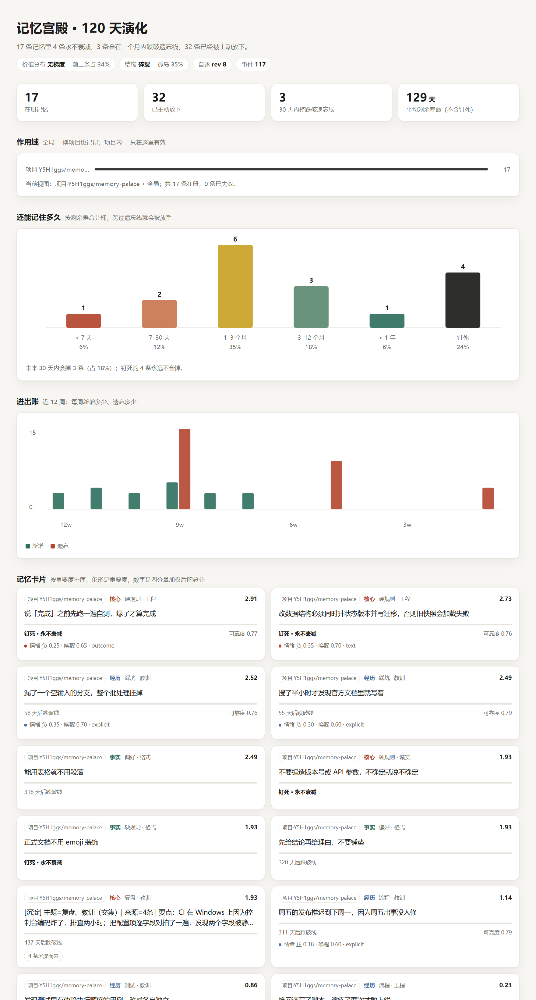
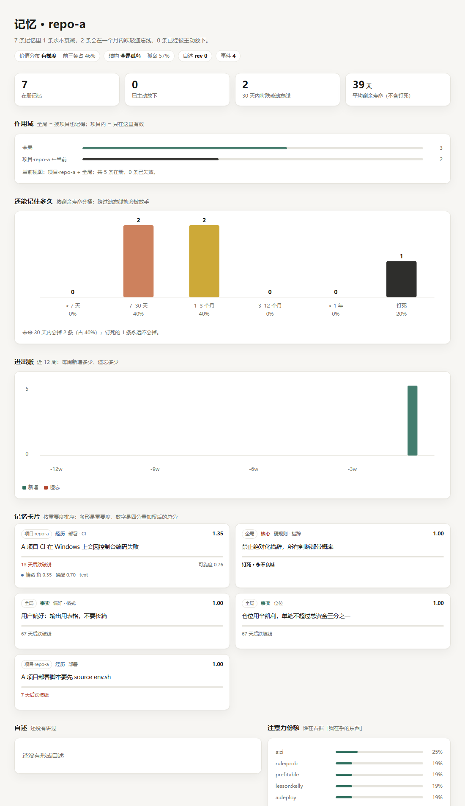
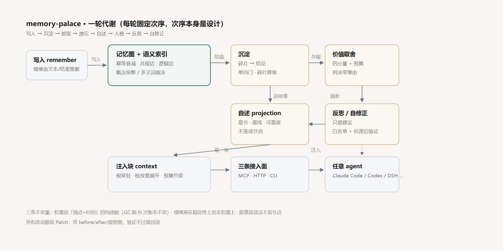

# memory-palace

> 一个会遗忘、会被情绪加固、会讲自己故事的记忆系统。
> 零第三方依赖 · 三行接入任意 agent。

[](https://github.com/Y5H1ggs/memory-palace/actions/workflows/ci.yml)
[](LICENSE)
[](pyproject.toml)
[](pyproject.toml)



<p align="center"><sub>↑ 由 <code>memory-palace render</code> 从一份 120 天的演示库直接生成（<a href="docs/sample-palace.html">在线样例</a>）。图上的每个数字都能用一条命令复现。</sub></p>

**TL;DR (English)** — A dependency-free Python implementation of a *memory lifecycle*: idempotent decay, affect that both hardens and distorts recall, consolidation with a one-way door, value-based forgetting with a fixed attention budget, self-narrative as a projection, tree-shaped injection to save tokens, and self-correction bounded by whitelist + value ranges + **multi-objective guardrails**.

0.10.0 adds the three things that were missing for real deployments: a **SQLite/WAL backend** (row-level writes, single-writer-many-readers, crash recovery, commit ledger — a single `remember` went from 47 ms to 1.2 ms at 1k memories), a **plug-and-play embedding channel** (built-in hashing embedder or any OpenAI-compatible `/v1/embeddings`), and a **labelled component benchmark** (retrieval / abstention / dedupe / consolidation, two domains, published numbers including the bad ones). Cross-process writes are now serialized by `BEGIN IMMEDIATE` + reload-before-mutate, verified by a 4-process test. Optional LLM reflection proposes hypotheses; only whitelisted, guard-railed patches can change configuration.

Still true, still stated: this is not a drop-in replacement for a purpose-built vector database, and the built-in hashing embedder does not solve synonymy — hook a real model if you need that (numbers below).

---

## 它解决的不是「存不下」，是「记不住该记的」

| 问题 | 向量库 / RAG | 这里 |
|---|---|---|
| 三个月没想起的事，该不该还在？ | 在，除非你删 | 按强度 + 价值判，还会随叙事地位退潮 |
| 情绪强烈的事是不是更难忘？代价是什么？ | 不知道 | 是，而且**越情绪化越可能是错的** |
| 十条碎片什么时候变成一条结论？ | 不会 | 结构 + 语义双通道结晶，单向门 |
| 我「选择」忘掉什么，凭什么？ | 不涉及 | 四分量重要性 + 审计理由 + 固定预算 |
| 「我是谁」是图里的一个节点吗？ | 是 | 不是。自述是读图的方式，是投影 |
| 我上个月的主张，现在还算数吗？ | 两句话一起端给你，自己猜 | 旧事实**到期**而不是被删：默认只取现在的，`as_of` 能回看当时的 |
| 我问的东西它其实没记过，会怎样？ | 把最像的几条凑上来 | **弃答**：明确说「没有相关记忆」，只保留钉死的硬规则 |
| 同一句话记了三次呢？ | 三个近似条目互相挤预算 | 几乎一字不差就合并；补了新内容的不合并（长度比把关） |
| 记忆多了，注入会不会撑爆上下文？ | 会 | 树状注入：根常驻、枝按需展开、其余折叠 |
| 系统能不能自己调参？到哪停？ | 不涉及 | 12 个白名单参数，超范围只能上报给人 |

一句话：**这里建模的是记忆的生命周期，不是检索的一次调用。**

## 60 秒上手

```bash
git clone https://github.com/Y5H1ggs/memory-palace.git && cd memory-palace
python examples/quickstart.py         # 不装包也能跑
python -m memory_palace.demo          # 全剧本断言 + 突变审计（约 1 秒）
python -m memory_palace.bench 1000    # 性能（含单次写入 p50/p95）
python -m memory_palace.cli eval      # 组件级评测：召回/弃答/去重/沉淀
```

```python
from memory_palace import MemoryPalace, MutableClock

palace = MemoryPalace(path="~/.memory-palace/store.sqlite")   # 默认 SQLite（WAL）
palace = MemoryPalace(clock=MutableClock())                    # 纯内存，测试用
palace.remember("rule:test", "说「完成」之前先跑一遍自测，绿了才算完成", tier="core", pinned=True)
palace.remember("ci:cp1252", "CI 在 Windows 上因为控制台编码炸了，排查两小时", tags=("复盘", "教训"))

palace.recall(query="怎么避免重复踩坑")        # 语义召回：标签零重叠也命中
palace.graph.get("ci:cp1252").affect         # 情绪由文本推断，带依据
palace.run_cycle()                           # 沉淀 → 抓取 → 遗忘 → 自述 → 人格 → 反思 → 自修正
```

命令行等价（agent 走这条）：

```bash
memory-palace context --query "怎么避免线上事故" --budget 800   # ← 会话开始：注入一块
memory-palace remember "周五不发布，出事没人修" --tags 流程,教训
memory-palace outcome m:719af3d5 contradicted                  # 用户纠正了你
memory-palace cycle                                            # 会话结束：代谢一轮

memory-palace fsck                                             # 校验和 / 完整性 / 悬空边 / 锁持有者
memory-palace journal --limit 5                                # 提交账本：谁在什么时候写了什么
memory-palace export backup.mpal                               # 一份能搬走的档案（带 sha256）
```

## 看得见：三层可见物

记忆系统改的是 prompt 里的一小段 —— **用户看不见**。「用了很久」和「根本没生效」，体验上一模一样。
所以这里有三层可见物，都来自同一份真实数据：

| | 命令 | 看到什么 |
|---|---|---|
| **一行状态** | `context --status-only` | `[记忆 6/9 · 钉死 2 · 147/900字 · 自述 rev1]` |
| **终端视图** | `view` | 谁最重要、谁最快被忘掉、已经忘了什么 |
| **HTML 面板** | `render --out x.html` | 单文件自包含：寿命分布、进出账、卡片、自述、墓碑 |


面板不是仪表盘，是**记忆的体检报告**。三条读法：最先触底的那几条就是系统认为最该放手的；
条形长但寿命短 = 现在很亮、但很快会淡（多数琐事本该如此）；墓碑不是失败，是取舍 ——
全部保留，等于没有取舍。

> 演示库里显示「无梯度」是真实结论，不是 bug：17 条记忆的年龄与使用频次太接近，
> 系统诚实地告诉你「这套记忆还没有形成取舍」。

## 接进任何 agent：MCP / HTTP / CLI

不是某个平台的专用件。三个接入面，语义完全一致：**`context` 注入 / `remember` 固化 / `cycle` 代谢**。

| 接入面 | 谁用 | 一行启动 |
|---|---|---|
| **MCP**（stdio，8 个工具） | Claude Code、Codex CLI、Cursor、Cline、Windsurf、Zed、Gemini CLI、**DSH** | `memory-palace-mcp` |
| **HTTP + OpenAPI 3.0** | Dify、Coze、n8n、自定义 GPT Actions、低代码 | `memory-palace-http --port 8765` |
| **CLI / 库** | 自己写循环的 agent、脚本、定时任务 | `memory-palace context …` |

```json
// Claude Code / Cursor：.mcp.json
{ "mcpServers": { "memory-palace": { "command": "memory-palace-mcp",
  "env": { "MEMORY_PALACE_STORE": "~/.memory-palace/store.json" } } } }
```

```yaml
# DSH（DeepSeek Harness）：~/.dsh/profiles/<profile>/cordis.patch.yml
- insert:
    - id: mcp-memory-palace
      name: '@deepseek-ai/dsh-mcp-client'
      config:
        serverName: memory-palace
        transport: stdio
        command: python
        args: ['-u', '-m', 'memory_palace.mcp_server', '--profile', 'slim']
        cwd: /path/to/memory-palace
        env:
          MEMORY_PALACE_STORE: /Users/you/.memory-palace/store.json
          PYTHONPATH: /path/to/memory-palace
        toolCallTimeoutMs: 30000
```

- 各宿主完整配置（Claude Code / Codex / Cursor / Cline / Windsurf / Zed / Gemini CLI / DSH /
  Dify / Coze / n8n / LangChain / OpenAI function calling）：[docs/INTEGRATIONS.md](docs/INTEGRATIONS.md)
- 三种接入时机、多库划分、**什么时候不该用**：[docs/AGENT_INTEGRATION.md](docs/AGENT_INTEGRATION.md)
- agent 读得懂的约定：[AGENTS.md](AGENTS.md)

### 省 token 的两个开关

DSH 这类宿主会把**全部工具定义常驻上下文**（不支持 Tool Search），每轮都要付 schema 的钱：

```bash
memory-palace-mcp --profile slim    # 只暴露 context / remember / cycle 三个工具
memory-palace-mcp --profile full    # 8 个（默认）
```

## 树状记忆：分层付费

扁平注入每条都要付全额 token。12 条还能忍，120 条只有两条路：截断（丢刚需）或全塞（爆预算）。
树状给第三条：**根常驻、命中的枝展开到叶子、其余折叠成一行摘要**，并显式标注「另有 N 条」。

```
# 记忆树（49 条 → 根 4 / 枝 6，展开 1 枝，412/700 字）
├─ [钉死] 说「完成」之前先跑一遍自测，绿了才算完成
├─ [钉死] 改数据结构必须同时升状态版本并写迁移…
├─ 复盘（14）· CI 在 Windows 上因为控制台编码炸了…
│  · 排查两小时，教训：终端输出统一 UTF-8
│  · …另有 12 条（recall 取）
└─ 其余 3 个主题（21 条）：工程、流程、琐事
```

`python -m memory_palace.bench`，1000 条记忆的实测：

| | 耗时 | 注入字数 |
|---|---|---|
| 扁平（6 条） | 15 ms | 375 字 |
| 扁平（30 条，要覆盖面） | 17 ms | 1185 字 |
| **树（同覆盖面）** | **1.1 ms** | **622 字（省 47%）** |

诚实说明：**窄预算（只要 6 条细节）时树反而略贵**（622 vs 375 字），因为它默认给全貌。
两种注入不是替代关系，是两个档位 —— 要细节用扁平，要知道「我有什么」用树。

## 性能：两次审计，七处改动，每步都有反事实证明

`python -m memory_palace.bench`（1000 条，本机，取三次中位数）：

| 指标 | 改前 | 改后 | |
|---|---|---|---|
| `cycle`（一轮代谢） | 530 ms | **108 ms** | **4.9×** |
| 查询（冷：索引脏，含全量重建） | 113 ms | **37 ms** | **3.0×** |
| 查询（热：索引干净） | 14.7 ms | **4.2 ms** | **3.5×** |
| 200 条的 `cycle` | 45 ms | **17 ms** | 2.7× |
| **读库**（JSON → 图，1000 条） | 142 ms | **34 ms** | **4.2×** |

端到端（一次 CLI 调用，本机中位数）：

| 环节 | 耗时 | 说明 |
|---|---|---|
| 解释器空转 | 111 ms | 环境地板（含 sitecustomize 65 ms），与我们无关 |
| + `import memory_palace` | +60 ms | 15 个模块 |
| + 读库 1000 条 | +30 ms | 反序列化 + 校验 |
| `context --query` 全流程 | **269 ms** | **其中我们的部分 156 ms** |

七处改动，按收益排序：

| 改动 | 原来慢在哪 | 改后 |
|---|---|---|
| **稀疏向量** | 余弦是纯 Python 稠密循环：263 维里 245 个是零，44k 次调用 = 1170 万次乘加 | 只遍历非零分量（平均 18 个）：12.2µs → **1.6µs** |
| **聚类早停** | `max(结构, 0.85×余弦)` 中，结构侧已过线时余弦算了也白算 —— 实测 45262 对**全部**属于这种 | 结构过线即返回，余弦调用降到 **0** |
| **增量补建** | `sync()` 把「向量数 ≠ 节点数」当成「必须全量重建」；沉淀每造一条结论就重建一遍，一轮 `run_cycle` **8 次** | 只补缺失 O(k)，批末统一对齐 **1 次** |
| **校验合并** | `_validate` 逐元素 `isinstance`+`isfinite`+`float` 跑四遍 = 27µs，与整个编码（30µs）相当 | `math.fsum` 一次 C 层扫描 = **2µs** |
| **反射缓存** | 反序列化一条记忆问 20 多次「这个类有哪些字段」，1000 条 = 2.5 万次 `dataclasses.fields()` | `lru_cache`，读库 142→34 ms |
| **去掉两个重导入** | `statistics`（求中位数）17 ms、`html`（转义 5 个字符）11.7 ms，每次起进程都要付 | 本地 `_median` + `str.translate` |
| **索引按需构建** | 读库时立刻编码全库（37 ms），而 `status` / `view` 根本不查语义 | 只置脏，查询入口本来就有 `sync()` |

三条纪律保证「快」不是拿语义换的，每一条都有断言 + 对应变异：

1. 稀疏与稠密两条路径**逐条对分**（最大偏差 `0.0e+00`，集合差 0）
2. 早停**必须保序**（同一批候选，早停前后的簇结构逐字相同）
3. 增量补建**不许动已有向量**（按对象身份验证：31 条库里只编了新增那 1 条）

上面是 0.9.2 → 0.9.3 的对比（JSON 后端）。0.10 换 SQLite 之后**单次写入**的账是另一回事：
1000 条时 `remember` p50 从 47.1 ms 降到 **1.2 ms**（p95 1.5 ms），因为不再重写整个库；
改一条也只要 1.1 ms，与库的大小基本无关。查询侧不变（冷 46.6 ms / 热 4.3 ms），
读库 49 ms——行存储的解析比整份 JSON 略贵，换来的是写延迟与并发安全。

代价如实记账：`learn_concepts` + `IdfModel` 仍占冷查询的一半（1000 条约 29ms）。它们是对全语料的两遍扫描，
只在整个语料变了时才需要。**没有做增量** —— 增量 IDF 要维护 doc 级 df 与删除回滚，做错的代价
（IDF 与向量不同尺，余弦失去意义）比慢一点更贵。这一条写在这里，是待办不是已完成。


## 跨项目记忆：分层，而不是二选一



真实用法不是「全共享」或「全隔离」，而是**两层**：

| 层 | 放什么 | 换项目后 |
|---|---|---|
| `global` | 用户偏好、硬规则、通用教训 | **还在** |
| `proj:owner/repo` | 这个项目的架构决策、踩过的坑 | 不出现 |

```bash
memory-palace remember "以后输出用短段落" --scope global    # 跨项目共享
memory-palace remember "部署脚本要先 source env.sh"          # 默认落到当前项目
memory-palace context --query "部署" --scope project        # 只看本项目
memory-palace context --query "部署" --scope all            # 调试：全部作用域
memory-palace promote lesson:ci                             # 把项目教训升为通用
memory-palace projects                                      # 看分布
```

项目标识按 `--project` → `MEMORY_PALACE_PROJECT` → **git remote**（`proj:owner/repo`）→ 目录名+哈希
依次推断。用 git remote 而不是路径，是因为换目录、换机器、重新 clone 都该是同一个项目。

三个不显然但重要的决定：

1. **沉淀不跨项目**。A 项目的碎片和 B 项目的碎片绝不结晶成一条「结论」——
   那条结论会被两边都当成自己的。
2. **失效与作用域分开判**。被取代的旧事实由「历史保留期」回收，不参与价值 GC，
   否则一条曾经很重要的旧偏好会靠高重要性永远赖着。
3. **面板与读数跟随视图**。看着项目视图却报全库的熵，会让人误判「我的注意力很集中」，
   其实是被别的项目的数据摊平了。

## 设计



三条不变量，其余都是推论：

1. **权重是「锚点 + 时间」的纯函数**，不是余额。GC 跑一次和一百次，期末逐位相同
   （旧实现每天扣一点，遗忘速度取决于你多久扫一次）。
2. **情绪乘在稳定性上，不加在权重上**。加权重只是「更亮」；乘稳定性改变的是**衰减速度** ——
   这才是「怎么抓都抓不住的东西偏偏最难忘」。代价照收：唤醒越高，编码越可能被改写。
3. **叙事是投影，不是节点**。图里不会多出一个「我」；自述每次重新计算章节与选择理由。

| 模块 | 管什么 | 关键不变量 |
|---|---|---|
| `core` | 节点 / 图 / 幂等衰减 / 双时态 / 原子持久化 | 状态版本 v6，兼容读 v4/v5；事实有有效期 |
| `affect` | 潮水 / 河床 / 失真代价 + 评价器 | 写情绪 ≠ 强化记忆 |
| `logic` | 有向带类型的推理边 | 共现不是凭据，相似不是推出 |
| `consolidation` | 碎片 → 结论 | 单向门；碎片降级为溯源窗口 |
| `value` | 重要性 / 熵 / 结构熵 / 预算 | 结论按价值、碎片按强度，两套遗忘律 |
| `narrative` | 自述投影 | 叙事地位随时间退潮 |
| `persona` | 基座 / 人格 / 人设 / 修订 | 基座系统只读 |
| `memory_model` | 五种记忆五种寿命 | 超容量是降级不是删除 |
| `reflection` | 指标化回看 | 只提建议，绝不自动改配置 |
| `selfcorrect` | 自修正 | 白名单 + 值域 + 回滚 + 拒绝滞后指标 |
| `semantics` | 语义检索 | 多义词按上下文裁决；词典从语料自学 |
| `tree` | 树状注入 | 折叠必须显式标注「另有 N 条」 |
| `cli` | agent 入口（注入 / 写入 / 代谢） | 无关查询必须弃答；钉死规则永远在 |

## 证据

```bash
python -m memory_palace.demo        # 215 项断言 + 18 条突变审计（剧本 21 幕）
python tests/test_cli.py            # 30 项 CLI 契约（含树状注入 / 作用域 / 宿主配置 / 三层展现）
python tests/test_integrations.py   # 17 项 MCP / HTTP 协议层契约（含 slim 档）
python tests/test_temporal.py       # 23 项 双时态 / 去重 / 弃答（含反事实）
python tests/test_scope.py          # 24 项 跨项目分层 / 隔离 / 提升 / 迁移
python tests/test_extensions.py     # 14 项 编码器 / 外部反思的契约
python tests/test_lexicon.py        # 16 项 词法层（含 IDF 反事实）
python tests/test_pragmatics.py     # 26 项 语用层（撤回≠同意 / 模糊降级）
python tests/test_audit.py          # 29 项 代码审计：优化保序 / 并发 / 边界校验 / 落盘一致
python tools/greenlight_audit.py    # 绿灯体检：22 个变异，改坏实现看断言会不会红
python -m memory_palace.bench       # 性能与 token 基准
```

自测里最有价值的不是「全绿」，是那 22 条**突变审计**：故意把实现弄坏（衰减带副作用、去掉风格裁决、
假语义全零向量、白名单失效、结构熵写死……），断言必须变红。其中一条自己写错过 ——
用 `lr=1.0` 制造「无惯性」，结果一步撞天花板，饱和伪装成惯性；已改成常数学习率的反事实并写进注释。

## 词法层：语义的地基，也是最容易悄悄骗人的地方

完整设计与性能账见 [docs/LEXICON.md](docs/LEXICON.md)。

原来的字符维是「每对字符等权加一，哈希进 64 个桶」——于是 `输出`（满语料都是）
和 `凯利`（只出现两次）权重相同。后果不是"召回不准"，是**沉淀把无关的两件事写成一条结论**。

现在：

| 处理 | 做法 | 一个具体后果 |
|---|---|---|
| 归一 | NFKC + 小写 | `ＵＴＦ－８` / `utf-8` / `UTF8` 是同一个词 |
| 分词 | 中文双字 + 标识符（`env.sh` → `env.sh`/`env`/`sh`） | 技术文本里的标识符不再是噪声 |
| 否定词 | `不没无非别勿禁未莫` 单字保留并 ×2 | 「不追高」与「追高」余弦 0.359，不是 1.0 |
| IDF | `log((N+1)/(df+1))+1`，语料现算 | 见下 |

**核心证据**（`tests/test_lexicon.py` 的反事实）：

| | 「构建机输出乱码」vs「输出用表格」 | 会聚吗 |
|---|---|---|
| 关掉 IDF | 0.783 | 会（错） |
| 打开 IDF | **0.448** | 不会（对） |

同时「输出用表格」与「输出优先精简」仍然聚成一类——**该分的分开，该合的还合**。

词法层当初带来的代价（200 条 `cycle` 19→51 ms）已在 0.9.2 收回：现在 17 ms、热查询 0.9 ms（见「性能」一节）。
三个缓存把损失从 12 倍压到 2.6 倍。详见 [docs/LEXICON.md](docs/LEXICON.md)。

## 语用层：一句话是在做什么事

词法层解决「有哪些词」，语义层解决「和哪条像」，但决定**该不该记、记成什么**的是第三层。

| 说法 | 行为 | 强度 | 该怎么记 |
|---|---|---|---|
| 以后都别用表格了 | 禁令 | 0.90 | core |
| 别用表格 | 禁令（弱） | 0.72 | fact（可协商） |
| 能不能别用表格 | **请求** | 0.55 | event（可以拒绝） |
| 表格是不是有点多 | 不满/暗示 | 0.35 | event + 「未确认」 |
| 我上次说过别用表格 | **纠正** | 0.85 | 重点不是表格，是「你没记住」 |
| **随便你** | **撤回** | 0.25 | event，**绝不等于同意** |

注入块里会直接标出来，模型能看见差别：

```
- [格式] 以后都别用表格了（禁令）
- [格式] 表格是不是有点多（不满·未确认）
- [格式] 随便你（撤回（不等于同意））
```

三条原则：**只标不猜到底**（每条判断带 evidence 与 confidence）、
**强度是乘出来的**（「我觉得可能不要」= 0.9×0.6 = 0.54，只配 event）、
**否定与模糊分开**（否定改命题，模糊改承诺度）。

两级衰减：禁令 force≥0.8 才进 core，<0.8 退到 fact；带模糊限定的 fact 再退到 event。
`auto_tier` 只是「建议一个层级」，不是「自动立法」，调用方永远可以覆盖。

完整设计、边界与那次抓到的假绿见 [docs/PRAGMATICS.md](docs/PRAGMATICS.md)。

## 两个扩展点：默认零依赖，但你可以换掉

默认实现是明码标价的取舍，不是天花板。两个钩子都在构造函数上，不传就是当前行为。

**① 语义编码器** —— 默认是「概念种子 + 字符 bigram」，抓不到同义改写：

```python
class BgeEncoder:                      # 任意 embedding：本地 ONNX / API 都行
    dim = 512
    def encode(self, text): return model.encode(text, normalize_embeddings=True).tolist()

palace = MemoryPalace(encoder=BgeEncoder())   # 沉淀与检索**同时**换掉
```

实测：同义改写 cosine 0.057 → 0.949；标签不同也能聚成一类。
`python examples/custom_encoder.py` 可直接看对比输出。

**② 外部反思** —— 默认是规则化监控（阈值 → finding），不是 LLM 反思：

```python
palace = MemoryPalace(reflector=lambda payload: ask_llm(json.dumps(payload)))
```

三条护栏：只追加观察并标来源、**不能改配置**（参数仍归规则与自修正）、
失败只记 `reflector_error` 不炸穿代谢。

为什么不是默认开：加上模型就不是零依赖了。为什么保留：规则监控只能发现"预设的问题"，
发现不了"我没预料到的模式"—— 后者才是反思。

三条常见批评的逐条核查（含一条被截断的代码引用）见
[docs/CRITIQUE_RESPONSE.md](docs/CRITIQUE_RESPONSE.md)。

## 与同类项目的取舍

Mem0 / Zep(Graphiti) / Letta / Cognee / TencentDB Agent Memory / progressive-memory 都看过一遍，
结论写在 [docs/COMPETITIVE_ANALYSIS.md](docs/COMPETITIVE_ANALYSIS.md)。摘要：

- **融合了三处**（都是补语义漏洞，零新依赖）：Zep 式**双时态**、LongMemEval 单列一档的**弃答**、
  Mem0 式**写入去重**（外加一条它们也没写的长度比约束）。
- **拒绝了五项**：LLM 抽取事实、上图数据库、换真实 embedding、core memory 全量常驻、多租户面板。
  理由分别是：破坏零依赖 / 只换来"看起来专业" / 放弃离线可审计 / 预算会被吃光 / 那是服务端产品的事。
- **还缺一件**：**组件级评测集**。业界那三个 benchmark 已经出现"评测腐化"——LoCoMo 全文仅约 26k tokens，
  128k 上下文的模型直接塞进去就能得高分；独立审计发现它约 6.4% 的答案键是错的。
  所以下一步不是加功能，是建一个 50 条真实记忆 + 20 条查询、能测**遗忘正确性**与**弃答假阳性率**的评测。

## 存储：SQLite（WAL）为主，JSON 为可移植备份

**为什么换了。** 以前每次 `remember` 都把整份 JSON 重写一遍（1000 条 ≈ 1.3 MB）。
单进程里这只是慢；多进程里它是个结构问题：两个进程各读一份再各写一份，
最后一次覆盖前面全部修改，**而且没有任何一方报错**。原子写保证「文件不坏」，
不保证「改动不丢」—— 这两件事经常被混为一谈。

现在默认是 SQLite（WAL 模式，`sqlite3` 是标准库，零依赖这条线没破）：

| | JSON（0.9.x） | SQLite（0.10） |
|---|---|---|
| 单次 `remember` p50（1000 条） | 47.1 ms | **1.2 ms** |
| 单次 `remember` p95 | 53.2 ms | **1.5 ms** |
| 写放大 | 每次重写全库 | **只写变动的行**（改一条 = 1 行） |
| 多进程写 | 覆盖丢更新 | `BEGIN IMMEDIATE` 排队 + 变更前重载 |
| 崩溃恢复 | 快照 + 追加日志前滚 | WAL 自前滚 + 提交账本 |
| 读库（1000 条） | 43 ms | 49 ms |
| 磁盘占用 | 1.3 MB | 4.3 MB（行存储 + 4 个索引） |

读库略慢、占盘略大，是行存储与索引的代价，换取的是写延迟 39×、并发安全与可查询的历史。

**五个文件，各管一件事**（SQLite 后端是一个库 + WAL，JSON 后端是快照 + 日志 + 提示 + 锁）：

```
store.sqlite          nodes / edges / tombstones / blobs / events / commits / snapshots
store.sqlite-wal      WAL：崩溃后自前滚
store.json            JSON 后端：单份扁平快照（顶层就是 config / graph / events）
store.json.journal    JSON 后端：追加日志，CRC32 + zlib，尾部半条会被丢弃
store.json.lock       JSON 后端：跨进程字节锁（Windows msvcrt / POSIX flock）
```

**「不可再生数据」具体做了什么**：

| 措施 | 防的是什么 |
|---|---|
| 快照带 sha256 校验和 | 文件被改了一个字，读的时候当场发现（不是安静地读进一份错数据） |
| 追加日志（CRC32 + 内容 sha256） | 快照坏了 → 从日志前滚；断电写了半条 → 丢它，前面的不丢 |
| `commits` 账本（只增不改） | 「上周三那次修改之前是什么样」；每次提交的原因、写者、写入行数、摘要 |
| `events` 表只追加 | 内存里的事件会被 trim，库里的不会 —— 审计原料不随内存回收蒸发 |
| `export` / `import`（带 sha256） | 数据能离开这台机器。不能导出的持久化只是「暂时还没丢」 |
| `fsck` / `repair` | 完整性、悬空边、账本与 meta 是否一致；修复前先备份，不动节点内容 |

```bash
memory-palace fsck            # ok=True / integrity=ok / orphan_edges=0
memory-palace journal         # rev 时间 原因 写者
memory-palace export out.mpal # 一条命令带走全部记忆
```

**JSON 后端保留的理由**：一份文件就是一个完整快照，能进 git、能发给别人、能当冷备。
`--backend json` 切回去，`--backend auto`（默认）按扩展名判断。

## 多进程并发写同一份记忆

以前这里写的是「不行，且不假装行」。现在可以说行了，但要把**机制**说清楚，
否则「支持并发」只是一句口号：

1. **写事务从第一毫秒就声明意图**：`BEGIN IMMEDIATE`，不是 `BEGIN`。
   后者要等到第一次写才升级锁，两个进程可能都读完才发现要抢同一个锁，白付一次重试。
2. **改之前先重载**：拿到写锁后先看 `meta.revision`，比自己新就把别人的提交读进来，再动手。
   反过来（先改后查）两边都认为自己最新，后写的一方盖掉前一方**已提交**的修改 ——
   这是丢更新最隐蔽的形态。
3. **只写自己脏掉的行**：节点上带 `_dirty` 标记（任何字段被改写即置位，读库后统一清零），
   提交时只 upsert 这些行。别人同时写别的节点，互不干扰。
4. **冲突要记账**：`SaveResult.rebased` 记录「我是叠在别人之后的第几版」，
   进 `conflicts` 计数，而不是假装没发生。

实测（`tests/test_store.py::test_multiprocess_no_lost_updates`，每次跑都过）：

| 场景 | 结果 |
|---|---|
| 4 个进程 × 15 条独立写入 | 60 条一条不少 |
| 4 个进程 × 15 次 merge 同一条记忆 | `access_count` 恰好 60，零丢更新 |
| 写完之后 `fsck` | `ok=True`，账本 revision 与 meta 一致 |
| 5 线程 × 40 次读同一条记忆 | `access_count` +200 |
| 9 线程同时 remember/recall/gc/cycle | 0 异常，钉死记忆不被误删 |

**边界，说清楚**：SQLite 的 WAL 是「单写多读」，写者之间排队。
高并发写同一热点时，吞吐上限就是一个写者 —— 这是 SQLite 的设计，不是 bug。
要更高写吞吐，正确做法是换服务端数据库，而不是在这上面加锁。另外 WAL 需要
本地文件系统（网络盘上的共享内存不可靠），这一点写进 `docs/STORAGE.md`。

## 向量通道：内置哈希 / 任意 OpenAI 兼容端点

先说它**不是**什么：内置的 `HashingEmbedder` 不是神经语言模型。它是
有符号特征哈希（feature hashing）+ 字符 n-gram + 子线性 TF 得到的 512 维稠密向量，
零依赖、确定性、对未登录词有平滑作用；但它仍然读字面，**不会**因为「读懂了」而把
「止盈」和「落袋为安」放到一起。那需要真模型 —— 所以这一层是可替换的：

```bash
# 零依赖，立刻可用
memory-palace config --set embedding_provider=hashing
memory-palace config --set hybrid_weight=0.45

# 接本地 BGE / vLLM / 任何 OpenAI 兼容端点
memory-palace config --set embedding_provider=http
memory-palace config --set embedding_endpoint=http://127.0.0.1:8000/v1/embeddings
memory-palace config --set embedding_model=bge-m3
memory-palace embed            # 看两条通道各自的状态与失败计数
```

换成真模型时，检索、聚类、去重、弃答**一起**换 —— 它们读的是同一个
`SemanticIndex`，不是各自实现一套「语义」。`dense_scores()` / `lexical_scores()` 保留，
用于对照「这条查询到底靠哪条通道命中」。

代价也如实说：512 维 × 1 万条 ≈ 20 MB 内存（`array('f')`，不是 Python list），
全表扫一次约 3 ms；嵌入服务抖了会降级到词法通道并记 `dense_failures`，
不会让整个检索不可用。**没上 ANN** —— 这个规模全表扫比维护索引结构更省心，
到 1e5 再换，接口不变。

## 组件级评测：把「我觉得变好了」换成数字

以前所有测试都是**我写的断言**。断言通过只证明「实现符合我的预期」，
不证明「检索真的好用」。中间隔着一个东西：**带标注的数据**。

`memory_palace/evaluation.py` 里有两套领域数据（A 股复盘 / 工程运维，
共 80 条记忆、42 条查询）与四类标注：检索 gold、弃答、去重对、沉淀簇。

```bash
memory-palace eval                              # 词法通道
memory-palace eval --channel hybrid             # 词法 + 稠密
memory-palace calibrate                          # 扫阈值，给推荐值与平台区间
memory-palace calibrate --apply                  # 写成 calibration.json
```

实测（k=5，本机）：

| 数据集 | 通道 | recall@5 | MRR | 精确匹配 | 换说法 |
|---|---|---|---|---|---|
| zh-finance | 词法 | 0.725 | 0.692 | 0.889 | **0.591** |
| zh-finance | 混合 | **0.800** | **0.763** | 0.889 | **0.727** |
| zh-tech | 词法 | 0.944 | 0.835 | 1.000 | 0.923 |
| zh-tech | 混合 | 0.944 | **0.861** | 1.000 | 0.923 |

读法：`exact` 上稠密通道没有增益（字面匹配本来就够），收益全部来自 `paraphrase`
（0.591 → 0.727）。**这正说明它替代不了真模型**：内置哈希只能补字面变形，
不能补语义跳转。想要后者，请接真模型，然后用同一张表验证它到底值不值。

另外两处数字不好看，但必须贴出来 —— 这才是评测集的意义：

| 指标 | 默认阈值 | 数字 | 说明 |
|---|---|---|---|
| 弃答 F1 | 0.20 | 0.857 / 1.000（两数据集） | **0.30 是错的**：短查询上误弃 5 条，F1 只有 0.5。0.18~0.21 是平台区，已把默认值从 0.30 下调到 0.20 |
| 去重 F1 | 0.92 | 0.667 / 1.000 | 财务集里「百分之五」vs「5%」长度差超过 15%，被长度保护挡掉 —— 保守是刻意的（合并会丢内容），但确实是漏 |
| 沉淀 F1 | 0.50 | 0.000 / 0.000 | 这两套数据的每条记忆标签各不相同，0.5 的门槛一条簇都出不来；扫描显示 0.25~0.30 才合适。**说明默认值是给「标签共享」的语料调的** |

`calibrate` 不只给最优点，还给**平台区间**：最优点常常是尖峰，旁边两步就掉一半；
取 ±0.1 内 F1 落差 ≤2 个点的区间中点，比取峰值稳。换语料就重扫一遍，别信默认值。

规模测试也在这条命令里（`--scale 1000 5000 10000`）：1e4 条以内，召回不掉、
单次查询 p95 在两位数毫秒。这一条是对「语料上万条会退化」那句话的正面回答 ——
以前它是对的，因为没人测过。

## LLM 反思：模型提假设，代码管边界

规则引擎能回答「哪个指标越界了」，回答不了「这一周到底发生了什么」。
前者是阈值告警，后者才是复盘。接上 LLM 之后分工是这样划的：

| 谁 | 干什么 | 可审计 |
|---|---|---|
| 规则引擎 | 算数字：指标、分位数、越界与否 | ✅ 可复算、可对账 |
| LLM | 读证据（指标 + 事件 + 记忆样本 + 自述），提假设与措辞 | ❌ 不可审计 |
| 代码 | 校验结构、白名单、值域、上限；模型的话一律先当「待验证提案」 | ✅ |

三道闸，任何一道破了都该关掉这个功能：

1. **模型不改配置**：只能输出 `suggested_params`，真正的改动走 `SelfCorrector`
   的白名单 + 值域 + 护栏 + 可回滚。让模型直接写配置，等于让它改自己的人格。
2. **输出必须结构化**：解析失败就退回规则引擎，并记 `degraded` + 错误原因。
   一段无法解析的自然语言不是「反思」，只是噪声。
3. **输入必须有界**：按字符预算截断，先丢记忆样本、再丢事件，**指标与参数清单永不截断**
   （踩过：总文本直接截断把参数清单砍了一半，模型照着半份清单提建议，看起来像在乱说）。

```bash
memory-palace config --set llm_provider=http
memory-palace config --set llm_endpoint=http://127.0.0.1:11434/v1/chat/completions
memory-palace config --set llm_model=qwen2.5:14b
memory-palace reflect          # 一次反思；没配 LLM 就是规则反思
```

## 多目标自修正：不许拿 A 换 B

以前判「这轮修正好不好」只看一个指标。单指标优化在真实系统里必然挤占别的指标
（把召回门槛压低，噪声就上来了），而账面上只看到好的一面。

现在每条修正都带一份**护栏快照**（应用那一刻的其它指标），判决要求：
主指标改善 ≥ `selfcorrect_effect_min`，**且**没有任何护栏指标相对恶化超过
`selfcorrect_guard_margin`（默认 15%）。恶化就回滚，并把越界的键与幅度写进
`patch.guard_hits`，在 `status()["guardrail_reverts"]` 里能查到。

方向是显式声明的（`GUARD_DIRECTIONS`）：`retrieval_coverage` 越高越好、
`forget_pressure` 越低越好。弄反会得到一个「越改越差才留下」的系统 ——
比没有护栏更糟，所以有专门的测试守着方向。

## 成熟度自评（先说不好听的）

上一版这张表打了 3/10，并明确写「不适用：生产级记忆后端 / 向量检索替代品 /
存不可再生数据 / 多进程并发写」。逐条对上，现在是这样：

| 维度 | 之前 | 现在 | 依据 |
|---|---|---|---|
| 设计完整度 | 9/10 | 9/10 | 机制闭环没变；新增的存储/嵌入/反思都遵守「默认关闭、边界显式」 |
| 工程实现 | 8/10 | **9/10** | SQLite WAL + 行级增量 + `BEGIN IMMEDIATE` + 提交账本 + fsck/export；跨进程锁有专门测试 |
| 测试可信度 | 8/10 | **8.5/10** | 97 个 pytest + demo 全剧本 + 22 条突变审计；**新增带标注组件评测**，但标注集只有 80 条记忆（规模小、单一标注者） |
| 可维护性 | 6/10 | 6/10 | `palace.py` 1800+ 行、`demo.py` 2100+ 行照旧；新模块各自 300~700 行，边界清楚 |
| 生产就绪 | 3/10 | **7/10** | 并发写有机制有测试、崩溃恢复有账本、导出可迁移、写入 p50 1.2 ms；仍缺：多写者吞吐（SQLite 单写者）、SLA 承诺、API 冻结 |

**五个风险的现状**：

| 风险 | 现状 |
|---|---|
| ① 语义层不是 embedding | 有了稠密通道（哈希 / 任意 OpenAI 兼容端点），并且**用标注集量出了它值多少**：换说法召回 0.591→0.727。仍不解决同义跳转，需要真模型 |
| ② 测试通过 = 我写的断言通过 | 新增组件级评测（两个领域、四类标注），并且用它的结论**改掉了默认值**（弃答线 0.30→0.20）——这是断言做不到的事 |
| ③ 自修正的「变好」仍是单指标 | 多目标护栏 + 方向声明 + 越界证据可查；有测试证明「主指标变好但护栏崩了会被退回」 |
| ④ 单写者 | SQLite `BEGIN IMMEDIATE` + 变更前重载 + 行级增量；4 进程 × 15 次 merge 的丢更新测试每次跑都过 |
| ⑤ 没有组件级评测集 | 有，且报告里保留了不利数字（去重 0.667、沉淀 0.000）——不藏坏数才叫评测 |

**仍然不适用**（说清楚比说好听重要）：

- 不是**专用向量数据库**的替代品：没有 ANN、没有十亿级分片。1e4 条以内够用，再大请换。
- 不承诺**多写者高吞吐**：SQLite 单写者，写热点会排队。
- 不是**分布式**记忆：单机文件，WAL 需要本地盘。
- 标注集是**一个人标的 80 条**：能验证流程与量级，不能替代你自己的语料评测
  （`calibrate` 就是给你换语料用的）。


## 项目结构

```
memory_palace/
  core.py              节点 / 图 / 幂等衰减 / 配置 / 原子持久化
  affect.py            情感三维 + 评价器（情绪从哪来）
  logic.py             有向推理图
  consolidation.py     沉淀（双通道聚类 + 单向门）
  value.py             重要性 / 熵 / 结构熵 / 预算 / 审计判决
  narrative.py         自述投影
  persona.py           基座 / 人格 / 人设 / 修订
  memory_model.py      五种记忆五种寿命
  reflection.py        指标化回看
  selfcorrect.py       自修正
  semantics.py         语义检索（词法通道 + 稠密通道 + 混合打分）
  embedding.py         嵌入器：哈希（零依赖）/ 任意 OpenAI 兼容端点 / 磁盘缓存
  store.py             持久化门面：SQLite / JSON 两个后端 + 导出导入
  sqlite_store.py      SQLite（WAL）：行级增量、事务、提交账本、快照
  journal.py           追加日志（CRC32 + zlib + 前滚），JSON 后端的崩溃恢复
  locking.py           跨进程字节锁（msvcrt / flock）+ 持有者诊断
  llm.py               LLM 反思：结构化输出、白名单、预算截断、降级
  evaluation.py        组件级评测：两个领域、四类标注、阈值标定、规模基准
  tree.py              树状注入（根常驻 / 枝展开 / 折叠标注）
  scope.py             作用域：全局 / 项目 / 会话，项目标识推断
  lexicon.py           词法层：归一 / 分词 / 否定词 / IDF
  pragmatics.py        语用层：言语行为 / 强度 / 动机 / 场景
  palace.py            顶层编排
  cli.py               命令行
  mcp_server.py        MCP 服务（stdio，8 工具，slim/full 档）
  http_api.py          本地 HTTP + OpenAPI 3.0
  render.py            展现层（状态行 / 终端视图 / HTML 面板）
  bench.py             性能与 token 基准
examples/quickstart.py   60 行示例
examples/showcase.py     生成 120 天演示库与面板
examples/make_images.py  重新生成 README 配图（截图脚本）
examples/custom_encoder.py 换掉默认编码器（同义改写 → 可聚类）
docs/ARCHITECTURE.md     设计细节与次序的理由
docs/INTEGRATIONS.md     各宿主接入配置（含 DSH）
docs/AGENT_INTEGRATION.md 三种时机、成本、不该用的场景
docs/COMPETITIVE_ANALYSIS.md 同类项目调研：融合了什么、拒绝了什么、还缺什么
docs/CRITIQUE_RESPONSE.md 三条批评的逐条核查：哪条成立、哪条论据被截断
docs/LEXICON.md          词法层：四个决定、性能账、边界
docs/PRAGMATICS.md       语用层：行为分类、强度衰减、撤回≠同意
tools/greenlight_audit.py 绿灯审计：故意弄坏实现，看断言会不会红
dsh/                     DeepSeek Harness 插件（host 半 + cordis 挂载配置 + 面板）
AGENTS.md                agent 读得懂的约定
tests/test_temporal.py   双时态 / 去重 / 弃答（含反事实断言）
tests/test_scope.py      跨项目分层 / 隔离 / 提升 / 旧快照迁移
tests/test_extensions.py 编码器 / 外部反思两个扩展点的契约
tests/test_lexicon.py    词法层：归一 / 分词 / 否定 / IDF（含反事实）
tests/test_pragmatics.py 语用层：行为 / 强度 / 撤回≠同意 / 模糊降级
tests/test_audit.py      代码审计：优化保序 / 边界校验 / 增量补建（含反事实）
tests/test_store.py      持久化契约：4 进程并发 / 增量写 / 崩溃前滚 / 导出导入 / 校验和
tests/test_locking.py    跨进程锁：真子进程争用 / 重入 / 总超时 / 陈旧元信息
tests/test_embedding.py  嵌入：跨进程确定性 / 有符号哈希 / HTTP 批量与缓存 / 混合增益
tests/test_eval.py       评测集自审：标注合法性 / 指标数学 / 标定平台 / 规模基准
tests/test_llm.py        LLM 反思边界：结构校验 / 降级 / 白名单 / 绝不改配置
tests/test_guardrails.py 多目标护栏：主指标改善但护栏崩 → 回滚
```

## 版本

当前 `0.10.0`。`0.x` 期间 API 可能变。

升到 `1.0.0` 的四条硬条件，现在完成了三条半：

| 条件 | 状态 |
|---|---|
| 外部使用者 ≥ 1 | ⏳ 未达 |
| CI 覆盖三平台 | ✅ Linux / macOS / Windows |
| 语义层有公开评测集与基线数字 | ✅ 两个领域、四类标注、`eval` 一条命令复现 |
| 跨进程写锁落地 | ✅ SQLite WAL + 文件锁 + 4 进程丢更新测试 |

留着的半条是第一条 —— 它不该由我打分。

## License

MIT © 2026 Howard
