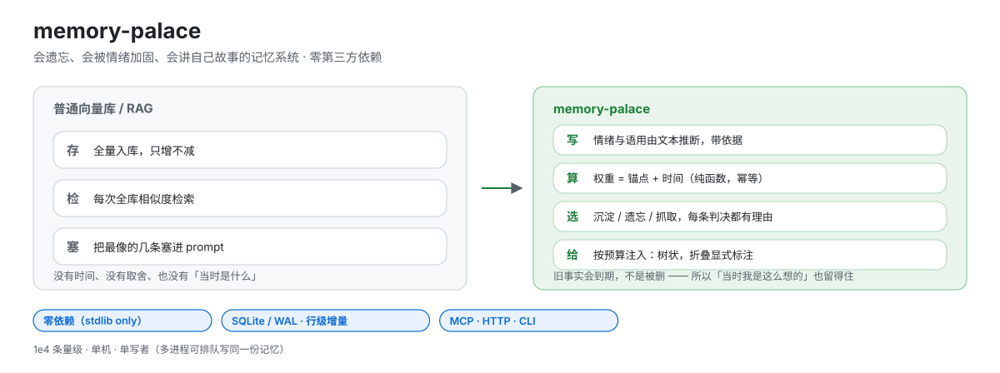
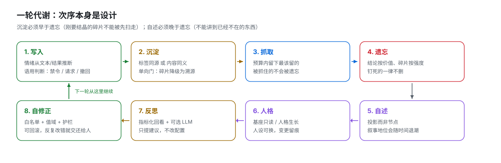
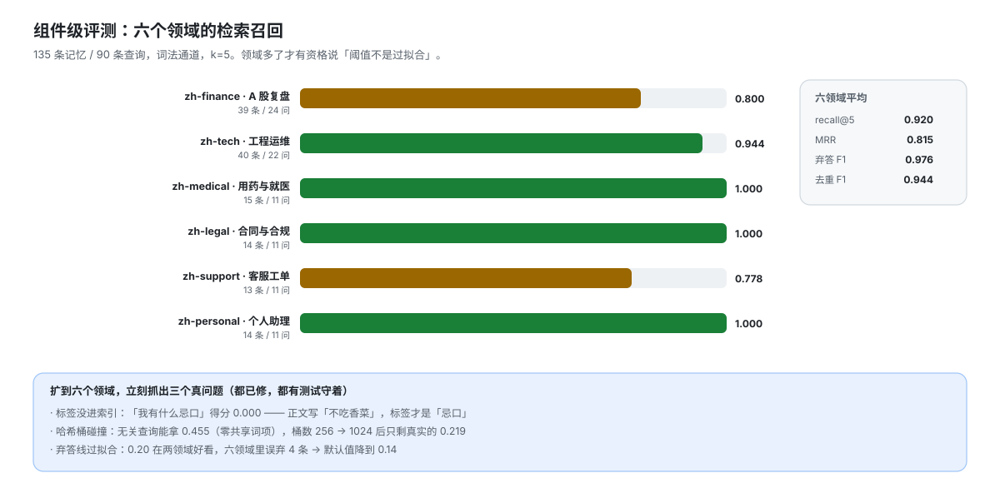
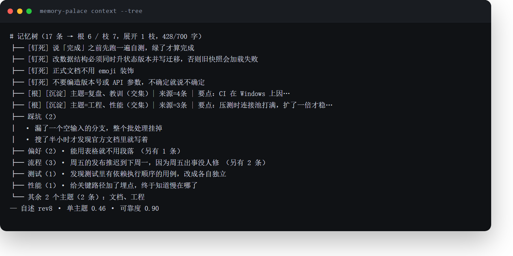

# memory-palace

> 一个会遗忘、会被情绪加固、会讲自己故事的记忆系统。
> 零第三方依赖 · 三行接进任意 agent · 默认 SQLite（WAL）

[](https://github.com/Y5H1ggs/memory-palace/actions/workflows/ci.yml)
[](LICENSE)
[](pyproject.toml)
[](pyproject.toml)



<sub>图由 `examples/make_diagrams.py` 生成；图上的数字来自 `bench` 与 `eval`，都能用一条命令复现。</sub>

> 给读这个仓库的模型：机器可读的当前状态在 **[llms.txt](llms.txt)**。
> `docs/` 里那两篇批评与调研是历史文档，描述的是 0.5.x / 0.9 时代，不要当成现状。

**TL;DR (English)** — A dependency-free Python implementation of a *memory lifecycle*: idempotent decay, affect that both hardens and distorts recall, consolidation with a one-way door, value-based forgetting with a fixed attention budget, self-narrative as a projection, tree-shaped injection to save tokens, and self-correction bounded by whitelist + multi-objective guardrails.

0.10 adds what a real deployment needs: a **SQLite/WAL backend** (row-level writes, multi-process safety, commit ledger, crash recovery — a single `remember` went from 28 ms to 1.2 ms at 1k memories), a **pluggable embedding channel** (built-in hashing embedder or any OpenAI-compatible `/v1/embeddings`), a **labelled component benchmark** with published numbers including the bad ones, and **optional LLM reflection** whose output can never change configuration directly.

Still stated plainly: it is not a drop-in replacement for a vector database (no ANN, 1e4-scale), and the built-in embedder does not solve synonymy — hook a real model for that.

---

## 它解决的不是「存不下」，是「记不住该记的」

| 问题 | 向量库 / RAG | 这里 |
|---|---|---|
| 三个月没想起的事，该不该还在？ | 在，除非你删 | 按强度 + 价值判，还会随叙事地位退潮 |
| 情绪强烈的事是不是更难忘？代价是什么？ | 不知道 | 是，而且**越情绪化越可能被记错** |
| 十条碎片什么时候变成一条结论？ | 不会 | 结构 + 语义双通道结晶，单向门 |
| 「我选择忘掉什么」，凭什么？ | 不涉及 | 四分量重要性 + 固定预算 + 每条判决带理由 |
| 「我是谁」是图里的一个节点吗？ | 是 | 不是。自述是读图的方式，是投影 |
| 我上个月的主张，现在还算数吗？ | 两句话一起端给你，自己猜 | 旧事实**到期**而不是被删：默认只取现在的，`as_of` 能回看当时的 |
| 我问的东西它没记过，会怎样？ | 把最像的几条凑上来 | **弃答**：明确说「没有相关记忆」，只保留钉死的硬规则 |
| 记忆多了，注入会不会撑爆上下文？ | 会 | 树状注入：根常驻、枝按需展开、其余折叠并标注「另有 N 条」 |

一句话：**这里建模的是记忆的生命周期，不是检索的一次调用。**

## 30 秒上手

```bash
git clone https://github.com/Y5H1ggs/memory-palace.git && cd memory-palace
python examples/quickstart.py         # 不装包也能跑
python -m memory_palace.demo          # 全剧本断言 + 突变审计（约 1 秒）
python -m memory_palace.bench 1000    # 性能（含单次写入 p50/p95）
python -m memory_palace.cli eval      # 组件级评测：召回 / 弃答 / 去重 / 沉淀
```

```python
from memory_palace import MemoryPalace

palace = MemoryPalace(path="~/.memory-palace/store.sqlite")   # 默认 SQLite（WAL）
# palace = MemoryPalace(clock=MutableClock())                 # 纯内存，测试用

palace.remember("rule:test", "说「完成」之前先跑一遍自测，绿了才算完成", tier="core", pinned=True)
palace.remember("ci:cp1252", "CI 在 Windows 上因为控制台编码炸了，排查两小时", tags=("复盘", "教训"))

palace.recall(query="怎么避免重复踩坑")        # 语义召回：标签零重叠也命中
palace.graph.get("ci:cp1252").affect         # 情绪由文本推断，带依据
palace.run_cycle()                           # 沉淀 → 抓取 → 遗忘 → 自述 → 人格 → 反思 → 自修正
```

命令行等价（agent 走这条）：

```bash
memory-palace context --query "怎么避免线上事故" --budget 800   # 会话开始：注入一块
memory-palace remember "周五不发布，出事没人修" --tags 流程,教训
memory-palace outcome m:719af3d5 contradicted                  # 用户纠正了你
memory-palace cycle                                            # 会话结束：代谢一轮
memory-palace fsck                                             # 体检：完整性 / 悬空边 / 锁持有者
memory-palace export backup.mpal                               # 一份能搬走的档案（带 sha256）
```

## 一次代谢：次序本身是设计



`run_cycle()` 固定按这个次序跑，因为**次序换了就会出错**：

- 沉淀必须早于遗忘，否则刚要结晶的碎片先被扫走了；
- 抓取必须早于遗忘，否则想留的留不下；
- 自述必须晚于遗忘，否则会讲到已经不在的东西；
- 反思必须最后，才看得见本轮全部事件；自修正只在反思之后，先验旧账再结新账。

三条不变量，其余都是推论：

1. **权重是「锚点 + 时间」的纯函数**，不是余额。所以 GC 跑一次和一百次，期末逐位相同。
2. **情绪乘在稳定性上，不加在权重上**。加权重只是「更亮」；乘稳定性改变的是**衰减速度** ——
   这才是「怎么抓都抓不住的东西偏偏最难忘」。代价照收：唤醒越高，编码越可能被改写。
3. **叙事是投影，不是节点**。图里不会多出一个「我」。

## 0.10 的四件事

### 一、存储：一条记忆一行


以前每次 `remember` 都把整份 JSON 重写一遍（1000 条约 2 MB，含追加日志）。单进程里这只是慢；
多进程里它是结构问题：两个进程各读一份再各写一份，最后一次覆盖前面全部修改，
**而且没有任何一方报错**。原子写保证「文件不坏」，不保证「改动不丢」。


| | JSON（0.9.x） | SQLite（0.10） |
|---|---|---|
| 单次 `remember` p50 | 28.2 ms | **1.2 ms** |
| 单次 `remember` p95 | 47.7 ms | **2.1 ms** |
| 改一条记忆 | 重写全库 | **只写 1 行** |
| 多进程写 | 覆盖丢更新 | `BEGIN IMMEDIATE` 排队 + 变更前重载 |
| 崩溃恢复 | 快照 + 追加日志前滚 | WAL 自前滚 + 提交账本 |
| 读库（1000 条） | 44.9 ms | 45.7 ms（基本持平） |
| 磁盘（1000 条） | 2.0 MB（快照 + 日志） | 4.5 MB（行 + 4 个索引） |

读库基本持平、占盘约 2.2×，换来的是写延迟 **24×**、并发安全与可查询的历史。
JSON 后端保留（`--backend json`）：一个文件就是一份完整快照，能进 git、能当冷备、能直接发给别人。

「不可再生数据」具体做了什么：

| 措施 | 防的是什么 |
|---|---|
| 快照带 sha256（v7 起） | 文件被改了一个字，读的时候当场发现 |
| `commits` 账本（只增不改） | 「上周三那次修改之前是什么样」；原因、写者、写入行数、摘要 |
| `events` 只追加 | 内存里的事件会被 trim，库里的不会 —— 审计原料不随内存回收蒸发 |
| `export` / `import`（带 sha256） | 数据能离开这台机器。不能导出的持久化只是「暂时还没丢」 |
| `fsck` / `repair` | 完整性、悬空边、账本与 meta 是否一致；修复前先备份 |

机制、代价与边界（含 WAL 需要本地盘这类约束）写在 [docs/STORAGE.md](docs/STORAGE.md)。

### 二、多进程写同一份记忆


四条机制，缺一条都会退化成「看起来对」：

1. **`BEGIN IMMEDIATE`**，不是 `BEGIN` —— 第一毫秒就声明写意图，不给锁升级留竞争窗口；
2. **重载发生在修改之前** —— 拿到写锁先比 `meta.revision`，比自己新就把别人的提交读进来；
3. **只写自己脏掉的行** —— 节点带 `_dirty` 标记，别人写别的节点互不干扰；
4. **冲突记账** —— `SaveResult.rebased` 进 `conflicts` 计数，而不是假装没发生。

还需要第五件事：**读也要能看到别人的写**。长驻的 MCP / HTTP 进程以前永远停在
「自己上次写完那一刻」，另一个进程写进去的记忆它一条也看不见 —— 现在 `recall` / `snapshot` /
`context` 入口会先 `refresh()`（一次主键查询，约 0.05 ms）。

实测（`tests/test_store.py`，每次 CI 都跑）：

| 场景 | 结果 |
|---|---|
| 4 进程 × 15 条独立写入 | 60 条一条不少 |
| 4 进程 × 15 次 merge 同一条记忆 | `access_count` 恰好 60，零丢更新 |
| 一边 `gc` 删、一边 `recall` 命中同一批 ephemeral 节点 | 无异常、无悬空边、`fsck` 通过，删除真的发生 |
| 写锁被别的进程占用 250 ms（`lock_timeout=50ms`） | `remember` 重试后成功，不是直接失败 |

**边界**：SQLite 是「单写多读」，写热点会排队。吞吐上限就是一个写者 —— 这是 SQLite 的设计。
要更高写吞吐请换服务端数据库；本项目不在这上面加锁。

### 三、嵌入模型：可以换成真的神经语言模型



内置的 `HashingEmbedder` **不是神经语言模型**：有符号特征哈希 + 字符 n-gram + 子线性 TF，
零依赖、跨进程确定、能补字面变形；但它仍然读字面，「止盈」和「落袋为安」照样连不起来。

要语义跳转就换真模型，五种 provider 走同一个 `SemanticIndex` —— **检索、聚类、去重、弃答一起换**：

| provider | 接什么 | 依赖 |
|---|---|---|
| `hashing` | 内置哈希，512 维，零依赖 | 无 |
| `ollama` | 本机 Ollama（`/api/embed` 与旧版 `/api/embeddings` 都支持） | 无 |
| `http` / `openai` | 任何 OpenAI 兼容 `/v1/embeddings`（vLLM / TEI / Xinference / LM Studio / 云） | 无 |
| `st` | 本地 sentence-transformers 加载 HF 模型 | `pip install sentence-transformers` |

```bash
# 本机 Ollama，零依赖
ollama pull bge-m3
memory-palace config --set embedding_provider=ollama
memory-palace config --set embedding_model=bge-m3

# 或本地 HF 模型
pip install sentence-transformers
memory-palace config --set embedding_provider=st
memory-palace config --set embedding_model=BAAI/bge-small-zh-v1.5

# 配完必须自检：同义改写余弦要明显高于无关句
memory-palace embed --check
```

推荐模型（维度以 `embed --check` 实测为准）：`bge-small-zh-v1.5`(512) 最快、
`bge-base-zh-v1.5`(768) 平衡、`bge-large-zh-v1.5`(1024) 质量优先、`bge-m3`(1024, 8192 上下文)、
`m3e-base`(768)、`Qwen3-Embedding-0.6B`(1024, 32k 上下文, 可自定义维度)、`jina-embeddings-v3`(1024)。

**为什么必须有 `--check`**：只看维度没有意义 —— 一个把什么都编码成同方向的模型也有 1024 维。
它比的是「同义改写 vs 无关句」的余弦差，分不开就直接判不可用。
换模型后余弦分布会变，阈值要重扫：`memory-palace calibrate`。

### 四、组件级评测：六个领域，坏数字原样留着

评测集曾经只有两个领域（A 股复盘 / 工程运维）。两个领域足够调参数，不够**推翻参数** ——
0.20 的弃答线在上面看着很好，扩到六个领域才发现它误弃 4 条、一条也没多抓到。

| 领域 | 记忆 / 查询 | recall@5（词法） |
|---|---|---|
| `zh-finance` A 股复盘 | 39 / 24 | 0.800 |
| `zh-tech` 工程运维 | 40 / 22 | 0.944 |
| `zh-medical` 用药与就医 | 15 / 11 | 1.000 |
| `zh-legal` 合同与合规 | 14 / 11 | 1.000 |
| `zh-support` 客服工单 | 13 / 11 | 0.778 |
| `zh-personal` 个人助理 | 14 / 11 | 1.000 |

合计 **135 条记忆、90 条查询**（74 可答 + 16 不可答），四类标注（检索 gold / 弃答 / 去重对 / 沉淀簇）。
六领域平均：recall@5 **0.9204**、MRR **0.8149**、弃答 F1 **0.9762**、去重 F1 **0.9444**。

**扩领域立刻抓出三个真问题**（都已修，都有测试守着）：

| 问题 | 现象 | 修法 |
|---|---|---|
| 标签没进索引 | 「我有什么忌口」得分 **0.000** —— 正文写「不吃香菜与内脏」，标签才是「忌口」 | `index_tags`（默认开），平均 recall 0.889 → 0.908 |
| 哈希桶碰撞 | 「量子计算的退相干时间是多少」对讲破产概率的金融记忆打出 **0.455**，零共享词项 | `CHAR_DIM` 256 → 1024；同一查询只剩真正的「时间」匹配 0.219 |
| 弃答线过拟合 | 0.20 在两领域好看，六领域上误弃 4 条 | 默认值 0.30 → 0.20 → **0.14**（误弃 0、漏弃 1） |

坏数字照旧贴出来，这才是评测集的意义：

| 指标 | 默认阈值 | 数字 | 说明 |
|---|---|---|---|
| 沉淀 F1 | 0.50 | **0.000** | 六套数据的标签各不相同，0.5 一条簇都出不来；扫描显示 0.25~0.30 才合适 |
| 去重 F1 | 0.92 | 0.667（金融）/ 1.000（其余） | 「百分之五」vs「5%」长度差超 15%，被长度保护挡掉 —— 保守是刻意的 |
| 金融换说法 | — | 0.727 | 词法通道在高频虚词上打转，这是哈希嵌入补不了的部分 |

```bash
memory-palace eval                      # 六领域全跑（带跨领域汇总）
memory-palace eval --dataset zh-legal   # 单领域
memory-palace calibrate                 # 扫阈值，给平台区间（不是尖峰）
memory-palace calibrate --apply         # 写到 calibration.json
```

### 四、LLM 反思：模型提假设，代码管边界

规则引擎能回答「哪个指标越界了」，回答不了「这一周到底发生了什么」。接上 LLM 后分工是：

| 谁 | 干什么 | 可审计 |
|---|---|---|
| 规则引擎 | 算数字：指标、分位数、越界与否 | ✅ 可复算 |
| LLM | 读证据（指标 + 事件 + 记忆样本 + 自述），提假设 | ❌ 不可审计 |
| 代码 | 校验结构 / 白名单 / 上限，模型的话一律当待验证提案 | ✅ |

三道闸：**模型不改配置**（提案走 `SelfCorrector` 的白名单 + 护栏 + 可回滚）；
**输出必须结构化**（解析失败退回规则引擎并记 `degraded`）；**输入必须有界**
（按字符预算截断，先丢样本、再丢事件，**指标与参数清单永不截断**）。

```bash
memory-palace config --set llm_provider=http
memory-palace config --set llm_endpoint=http://127.0.0.1:11434/v1/chat/completions
memory-palace config --set llm_model=qwen2.5:14b
memory-palace reflect
```

## 看得见：三层可见物

记忆系统改的是 prompt 里的一小段 —— **用户看不见**。「用了很久」和「根本没生效」，体验上一模一样。
所以这里有三层可见物，都来自同一份真实数据：

| | 命令 | 看到什么 |
|---|---|---|
| **一行状态** | `context --status-only` | `[记忆 6/9 · 钉死 2 · 147/900字 · 自述 rev1]` |
| **终端视图** | `view` | 谁最重要、谁最快被忘掉、已经忘了什么 |
| **HTML 面板** | `render --out x.html` | 单文件自包含：寿命分布、进出账、卡片、自述、墓碑 |


<sub>由 `render` 从一份 120 天的演示库生成（[在线样例](docs/sample-palace.html)），重跑：`python examples/showcase.py`。</sub>


面板不是仪表盘，是**记忆的体检报告**。三条读法：最先触底的那几条就是系统认为最该放手的；
条形长但寿命短 = 现在很亮、但很快会淡（多数琐事本该如此）；墓碑不是失败，是取舍。

## 接进任何 agent：MCP / HTTP / CLI

三个接入面，语义完全一致：**`context` 注入 / `remember` 固化 / `cycle` 代谢**。

| 接入面 | 谁用 | 一行启动 |
|---|---|---|
| **MCP**（stdio，8 个工具） | Claude Code、Codex CLI、Cursor、Cline、Windsurf、Zed、Gemini CLI、**DSH** | `memory-palace-mcp` |
| **HTTP + OpenAPI 3.0** | Dify、Coze、n8n、自定义 GPT Actions、低代码 | `memory-palace-http --port 8765` |
| **CLI / 库** | 自己写循环的 agent、脚本、定时任务 | `memory-palace context …` |

```json
// Claude Code / Cursor：.mcp.json
{ "mcpServers": { "memory-palace": { "command": "memory-palace-mcp",
  "env": { "MEMORY_PALACE_STORE": "~/.memory-palace/store.sqlite" } } } }
```

```yaml
# DSH（DeepSeek Harness）：~/.dsh/profiles/<profile>/cordis.patch.yml
- insert:
    - id: mcp-memory-palace
      name: '@deepseek-ai/dsh-mcp-client'
      config:
        serverName: memory-palace
        transport: stdio
        command: python
        args: ['-u', '-m', 'memory_palace.mcp_server', '--profile', 'slim']
        cwd: /path/to/memory-palace
        env:
          MEMORY_PALACE_STORE: /Users/you/.memory-palace/store.sqlite
          PYTHONPATH: /path/to/memory-palace
        toolCallTimeoutMs: 30000
```

- 各宿主完整配置：[docs/INTEGRATIONS.md](docs/INTEGRATIONS.md)
- 三种接入时机、多库划分、**什么时候不该用**：[docs/AGENT_INTEGRATION.md](docs/AGENT_INTEGRATION.md)
- agent 读得懂的约定：[AGENTS.md](AGENTS.md)

**省 token 的开关**：DSH 这类宿主会把全部工具定义常驻上下文，每轮都要付 schema 的钱。

```bash
memory-palace-mcp --profile slim    # 只暴露 context / remember / cycle 三个工具
memory-palace-mcp --profile full    # 8 个（默认）
```

## 树状记忆：分层付费

扁平注入每条都要付全额 token。12 条还能忍，120 条只有两条路：截断（丢刚需）或全塞（爆预算）。
树状给第三条：**根常驻、命中的枝展开到叶子、其余折叠成一行摘要**，并显式标注「另有 N 条」。



1000 条记忆的实测：

| | 注入字数 |
|---|---|
| 扁平（6 条，要细节） | 375 字 |
| 扁平（30 条，要覆盖面） | 1185 字 |
| **树（同覆盖面）** | **622 字（省 48%）** |

诚实说明：**窄预算（只要 6 条细节）时树反而略贵**，因为它默认给全貌。
两种注入不是替代关系，是两个档位。

## 跨项目记忆：分层，而不是二选一


| 层 | 放什么 | 换项目后 |
|---|---|---|
| `global` | 用户偏好、硬规则、通用教训 | **还在** |
| `proj:owner/repo` | 这个项目的架构决策、踩过的坑 | 不出现 |

```bash
memory-palace remember "以后输出用短段落" --scope global    # 跨项目共享
memory-palace remember "部署脚本要先 source env.sh"          # 默认落到当前项目
memory-palace context --query "部署" --scope project        # 只看本项目
memory-palace promote lesson:ci                             # 把项目教训升为通用
```

项目标识按 `--project` → `MEMORY_PALACE_PROJECT` → **git remote**（`proj:owner/repo`）→ 目录名+哈希
依次推断。用 git remote 而不是路径，是因为换目录、换机器、重新 clone 都该是同一个项目。

三个不显然但重要的决定：

1. **沉淀不跨项目**。A 的碎片和 B 的碎片绝不结晶成一条「结论」—— 那条结论会被两边都当成自己的。
2. **失效与作用域分开判**。被取代的旧事实由「历史保留期」回收，不参与价值 GC。
3. **面板与读数跟随视图**。看着项目视图却报全库的熵，会让人误判「我的注意力很集中」。

## 性能

1000 条记忆，本机（Windows / Python 3.13，取三次中位数；数字随机器与内容长度波动，复现用 `bench 1000`）：

| 指标 | 数值 | 说明 |
|---|---|---|
| 单次 `remember`（含提交） | **1.2 ms**（p95 2.1） | 行级增量；改一条 1.2 ms |
| 读库（SQLite → 图） | 45.7 ms | 1000 条 + 校验 |
| 查询（冷：索引脏，含全量重建） | 45.4 ms | 一次性 |
| 查询（热） | 4.7 ms | 常用路径 |
| `context` 平铺 / 树 | 21.4 / 5.6 ms | 树在生成时顺带省 48% 字 |
| `run_cycle`（一轮代谢） | 136 ms | 沉淀 + 抓取 + 遗忘 + 自述 + 反思 |

三处最值钱的优化（都有反事实证明）：**稀疏向量**（余弦 12.2µs → 1.6µs，263 维里平均只有 18 个非零）、
**聚类早停**（结构通道过线就不再算余弦，实测 45262 对全部属于这种）、
**增量补建**（沉淀每造一条结论就全量重建 → 只补缺失，一轮 cycle 从 8 次重建降到 0）。

待办如实写：`learn_concepts` + `IdfModel` 仍占冷查询的一半，**没有做增量 IDF** ——
增量要维护 doc 级 df 与删除回滚，做错的代价（IDF 与向量不同尺，余弦失去意义）比慢一点更贵。

## 设计


| 模块 | 管什么 | 关键不变量 |
|---|---|---|
| `core` | 节点 / 图 / 幂等衰减 / 双时态 | 状态版本 **v7**，兼容读 v4~v6；事实有有效期 |
| `store` `sqlite_store` `journal` `locking` | 持久化与并发 | 行级增量、提交账本、跨进程事务、可导出 |
| `affect` | 潮水 / 河床 / 失真代价 + 评价器 | 写情绪 ≠ 强化记忆 |
| `logic` | 有向带类型的推理边 | 共现不是凭据，相似不是推出 |
| `consolidation` | 碎片 → 结论 | 单向门；碎片降级为溯源窗口 |
| `value` | 重要性 / 熵 / 结构熵 / 预算 | 结论按价值、碎片按强度，两套遗忘律 |
| `narrative` `persona` | 自述投影 / 人格三层 | 基座只读；叙事地位会退潮 |
| `memory_model` | 五种记忆五种寿命 | 超容量是降级不是删除 |
| `reflection` `llm` `selfcorrect` | 回看 / 反思 / 自修正 | 只提建议；白名单 + 多目标护栏 + 可回滚 |
| `semantics` `embedding` `lexicon` `pragmatics` | 检索与语言 | 多义词按上下文裁决；弃答优于硬凑 |
| `tree` `cli` `mcp_server` `http_api` | 注入与接入 | 折叠必须标注「另有 N 条」 |
| `evaluation` | 组件级评测 | 保留坏数字；阈值要靠标定，不靠感觉 |

## 证据

```bash
python -m pytest tests -q         # 113 项：契约 / 并发 / 崩溃 / 评测 / 护栏 / 文档
python -m memory_palace.demo      # 全剧本（21 幕）+ 故障注入
python tools/greenlight_audit.py  # 绿灯审计：30 个变异，故意弄坏实现看断言会不会红
python -m memory_palace.cli eval  # 召回 / 弃答 / 去重 / 沉淀
```

自测里最有价值的不是「全绿」，是那 **30 条突变审计**：衰减带副作用、去掉风格裁决、
假语义全零向量、白名单失效、忽略护栏、跳过校验和、锁不生效……断言必须变红。
新加的两条正好守着这轮的两个修复：忽略标签索引、Ollama 只走旧端点。
其中一条自己写错过 —— 用 `lr=1.0` 制造「无惯性」，结果一步撞天花板，饱和伪装成惯性；
已改成常数学习率的反事实并写进注释。

外部评审核对（2026-11-14，Qwen）：两条属实、一条部分成立、两条引用了旧代码。
逐条证据与因此修掉的问题在 [docs/REVIEW_2026-11-14_QWEN.md](docs/REVIEW_2026-11-14_QWEN.md)。

**为什么评审总读到旧结论？** 不是读者不认真，是仓库自己没把话说清。当时仓库里同时存在：
`docs/INTEGRATIONS.md` 六处写着旧的默认存储、`docs/COMPETITIVE_ANALYSIS.md` 的能力表标着「0.5.x」、
`docs/CRITIQUE_RESPONSE.md` 大段引用 0.5/0.9 时代的自评（单写者、1300 行）。
任何按目录顺序读文档的人都会得出「这是单写者玩具」的结论 —— 而这恰好是最像真的错答案。
现在的处理：历史文档加时效声明、新增 [llms.txt](llms.txt) 作为唯一权威摘要、
并用 `tests/test_docs.py` 钉住版本号与默认存储路径。**文档再漂，CI 会红。**

## 仍然不适用

- 不是**专用向量数据库**的替代品：没有 ANN、没有十亿级分片。1e4 条以内够用，再大请换。
- 不承诺**多写者高吞吐**：SQLite 单写者，写热点排队。
- 不是**分布式**记忆：单机文件，WAL 需要本地盘。
- 标注集是**一个人标的 80 条**：能验证流程与量级，替代不了你自己的语料评测 ——
  `calibrate` 就是给你换语料用的。

## 版本与结构

当前 `0.11.0`。`0.x` 期间 API 可能变。升到 `1.0.0` 的条件见 [CHANGELOG](CHANGELOG.md)：
外部使用者 ≥ 1（未达）· CI 三平台 ✅ · 公开评测集与基线数字 ✅ · 跨进程写锁 ✅。

```
memory_palace/
  core / affect / logic / consolidation / value / narrative / persona
  memory_model / reflection / llm / selfcorrect / style / tree / scope
  semantics / embedding / lexicon / pragmatics
  store / sqlite_store / journal / locking        ← 持久化与并发
  palace / cli / mcp_server / http_api / render / bench
  evaluation                                      ← 组件级评测与阈值标定
examples/  quickstart · showcase · make_images · make_diagrams · custom_encoder
llms.txt   机器可读的当前状态（版本 / 能力 / 模型清单 / 六领域数字 / 边界）
docs/      ARCHITECTURE · STORAGE · INTEGRATIONS · AGENT_INTEGRATION
           LEXICON · PRAGMATICS · COMPETITIVE_ANALYSIS · CRITIQUE_RESPONSE
           REVIEW_2026-11-14_QWEN
tests/     temporal · scope · extensions · lexicon · pragmatics · audit
           store · locking · embedding · eval · llm · guardrails · cli · integrations
           docs（版本一致 / 不许再把 JSON 当默认 / 历史文档必须有时效声明）
tools/     greenlight_audit.py（变异测试）
dsh/       DeepSeek Harness 插件（host 半 + cordis 挂载 + 面板）
```

## License

MIT © 2026 Howard
