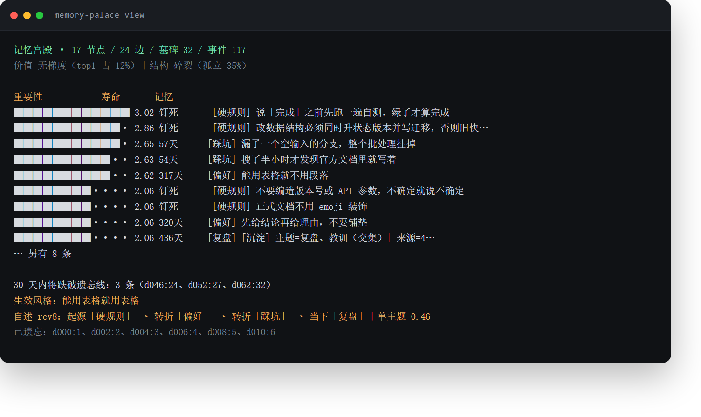

# memory-palace

> 一个会遗忘、会被情绪加固、会讲自己故事的记忆系统。
> 零第三方依赖 · 三行接入任意 agent。

[](https://github.com/Y5H1ggs/memory-palace/actions/workflows/ci.yml)
[](LICENSE)
[](pyproject.toml)
[](pyproject.toml)


<p align="center"><sub>↑ 由 <code>memory-palace render</code> 从一份 120 天的演示库直接生成（<a href="docs/sample-palace.html">在线样例</a>）。图上的每个数字都能用一条命令复现。</sub></p>

**TL;DR (English)** — A dependency-free Python implementation of a *memory lifecycle*: idempotent decay, affect that both hardens and distorts recall, consolidation with a one-way door, value-based forgetting with a fixed attention budget, self-narrative as a projection, tree-shaped injection to save tokens, and self-correction bounded by whitelist + value ranges + anti-lag verification. Ships MCP / HTTP / CLI. 395 assertions, 22 mutation audits. Not a vector database; not production-ready.

---

## 它解决的不是「存不下」，是「记不住该记的」

| 问题 | 向量库 / RAG | 这里 |
|---|---|---|
| 三个月没想起的事，该不该还在？ | 在，除非你删 | 按强度 + 价值判，还会随叙事地位退潮 |
| 情绪强烈的事是不是更难忘？代价是什么？ | 不知道 | 是，而且**越情绪化越可能是错的** |
| 十条碎片什么时候变成一条结论？ | 不会 | 结构 + 语义双通道结晶，单向门 |
| 我「选择」忘掉什么，凭什么？ | 不涉及 | 四分量重要性 + 审计理由 + 固定预算 |
| 「我是谁」是图里的一个节点吗？ | 是 | 不是。自述是读图的方式，是投影 |
| 我上个月的主张，现在还算数吗？ | 两句话一起端给你，自己猜 | 旧事实**到期**而不是被删：默认只取现在的，`as_of` 能回看当时的 |
| 我问的东西它其实没记过，会怎样？ | 把最像的几条凑上来 | **弃答**：明确说「没有相关记忆」，只保留钉死的硬规则 |
| 同一句话记了三次呢？ | 三个近似条目互相挤预算 | 几乎一字不差就合并；补了新内容的不合并（长度比把关） |
| 记忆多了，注入会不会撑爆上下文？ | 会 | 树状注入：根常驻、枝按需展开、其余折叠 |
| 系统能不能自己调参？到哪停？ | 不涉及 | 12 个白名单参数，超范围只能上报给人 |

一句话：**这里建模的是记忆的生命周期，不是检索的一次调用。**

## 60 秒上手

```bash
git clone https://github.com/Y5H1ggs/memory-palace.git && cd memory-palace
python examples/quickstart.py     # 不装包也能跑
python -m memory_palace.demo      # 215 项断言 + 18 条突变审计（约 1 秒）
```

```python
from memory_palace import MemoryPalace, MutableClock

palace = MemoryPalace(clock=MutableClock())
palace.remember("rule:test", "说「完成」之前先跑一遍自测，绿了才算完成", tier="core", pinned=True)
palace.remember("ci:cp1252", "CI 在 Windows 上因为控制台编码炸了，排查两小时", tags=("复盘", "教训"))

palace.recall(query="怎么避免重复踩坑")        # 语义召回：标签零重叠也命中
palace.graph.get("ci:cp1252").affect         # 情绪由文本推断，带依据
palace.run_cycle()                           # 沉淀 → 抓取 → 遗忘 → 自述 → 人格 → 反思 → 自修正
```

命令行等价（agent 走这条）：

```bash
memory-palace context --query "怎么避免线上事故" --budget 800   # ← 会话开始：注入一块
memory-palace remember "周五不发布，出事没人修" --tags 流程,教训
memory-palace outcome m:719af3d5 contradicted                  # 用户纠正了你
memory-palace cycle                                            # 会话结束：代谢一轮
```

## 看得见：三层可见物

记忆系统改的是 prompt 里的一小段 —— **用户看不见**。「用了很久」和「根本没生效」，体验上一模一样。
所以这里有三层可见物，都来自同一份真实数据：

| | 命令 | 看到什么 |
|---|---|---|
| **一行状态** | `context --status-only` | `[记忆 6/9 · 钉死 2 · 147/900字 · 自述 rev1]` |
| **终端视图** | `view` | 谁最重要、谁最快被忘掉、已经忘了什么 |
| **HTML 面板** | `render --out x.html` | 单文件自包含：寿命分布、进出账、卡片、自述、墓碑 |




面板不是仪表盘，是**记忆的体检报告**。三条读法：最先触底的那几条就是系统认为最该放手的；
条形长但寿命短 = 现在很亮、但很快会淡（多数琐事本该如此）；墓碑不是失败，是取舍 ——
全部保留，等于没有取舍。

> 演示库里显示「无梯度」是真实结论，不是 bug：17 条记忆的年龄与使用频次太接近，
> 系统诚实地告诉你「这套记忆还没有形成取舍」。

## 接进任何 agent：MCP / HTTP / CLI

不是某个平台的专用件。三个接入面，语义完全一致：**`context` 注入 / `remember` 固化 / `cycle` 代谢**。

| 接入面 | 谁用 | 一行启动 |
|---|---|---|
| **MCP**（stdio，8 个工具） | Claude Code、Codex CLI、Cursor、Cline、Windsurf、Zed、Gemini CLI、**DSH** | `memory-palace-mcp` |
| **HTTP + OpenAPI 3.0** | Dify、Coze、n8n、自定义 GPT Actions、低代码 | `memory-palace-http --port 8765` |
| **CLI / 库** | 自己写循环的 agent、脚本、定时任务 | `memory-palace context …` |

```json
// Claude Code / Cursor：.mcp.json
{ "mcpServers": { "memory-palace": { "command": "memory-palace-mcp",
  "env": { "MEMORY_PALACE_STORE": "~/.memory-palace/store.json" } } } }
```

```yaml
# DSH（DeepSeek Harness）：~/.dsh/profiles/<profile>/cordis.patch.yml
- insert:
    - id: mcp-memory-palace
      name: '@deepseek-ai/dsh-mcp-client'
      config:
        serverName: memory-palace
        transport: stdio
        command: python
        args: ['-u', '-m', 'memory_palace.mcp_server', '--profile', 'slim']
        cwd: /path/to/memory-palace
        env:
          MEMORY_PALACE_STORE: /Users/you/.memory-palace/store.json
          PYTHONPATH: /path/to/memory-palace
        toolCallTimeoutMs: 30000
```

- 各宿主完整配置（Claude Code / Codex / Cursor / Cline / Windsurf / Zed / Gemini CLI / DSH /
  Dify / Coze / n8n / LangChain / OpenAI function calling）：[docs/INTEGRATIONS.md](docs/INTEGRATIONS.md)
- 三种接入时机、多库划分、**什么时候不该用**：[docs/AGENT_INTEGRATION.md](docs/AGENT_INTEGRATION.md)
- agent 读得懂的约定：[AGENTS.md](AGENTS.md)

### 省 token 的两个开关

DSH 这类宿主会把**全部工具定义常驻上下文**（不支持 Tool Search），每轮都要付 schema 的钱：

```bash
memory-palace-mcp --profile slim    # 只暴露 context / remember / cycle 三个工具
memory-palace-mcp --profile full    # 8 个（默认）
```

## 树状记忆：分层付费

扁平注入每条都要付全额 token。12 条还能忍，120 条只有两条路：截断（丢刚需）或全塞（爆预算）。
树状给第三条：**根常驻、命中的枝展开到叶子、其余折叠成一行摘要**，并显式标注「另有 N 条」。

```
# 记忆树（49 条 → 根 4 / 枝 6，展开 1 枝，412/700 字）
├─ [钉死] 说「完成」之前先跑一遍自测，绿了才算完成
├─ [钉死] 改数据结构必须同时升状态版本并写迁移…
├─ 复盘（14）· CI 在 Windows 上因为控制台编码炸了…
│  · 排查两小时，教训：终端输出统一 UTF-8
│  · …另有 12 条（recall 取）
└─ 其余 3 个主题（21 条）：工程、流程、琐事
```

`python -m memory_palace.bench`，1000 条记忆的实测：

| | 耗时 | 注入字数 |
|---|---|---|
| 扁平（6 条） | 15 ms | 375 字 |
| 扁平（30 条，要覆盖面） | 17 ms | 1185 字 |
| **树（同覆盖面）** | **1.1 ms** | **622 字（省 47%）** |

诚实说明：**窄预算（只要 6 条细节）时树反而略贵**（622 vs 375 字），因为它默认给全貌。
两种注入不是替代关系，是两个档位 —— 要细节用扁平，要知道「我有什么」用树。

## 性能：两次审计，七处改动，每步都有反事实证明

`python -m memory_palace.bench`（1000 条，本机，取三次中位数）：

| 指标 | 改前 | 改后 | |
|---|---|---|---|
| `cycle`（一轮代谢） | 530 ms | **108 ms** | **4.9×** |
| 查询（冷：索引脏，含全量重建） | 113 ms | **37 ms** | **3.0×** |
| 查询（热：索引干净） | 14.7 ms | **4.2 ms** | **3.5×** |
| 200 条的 `cycle` | 45 ms | **17 ms** | 2.7× |
| **读库**（JSON → 图，1000 条） | 142 ms | **34 ms** | **4.2×** |

端到端（一次 CLI 调用，本机中位数）：

| 环节 | 耗时 | 说明 |
|---|---|---|
| 解释器空转 | 111 ms | 环境地板（含 sitecustomize 65 ms），与我们无关 |
| + `import memory_palace` | +60 ms | 15 个模块 |
| + 读库 1000 条 | +30 ms | 反序列化 + 校验 |
| `context --query` 全流程 | **269 ms** | **其中我们的部分 156 ms** |

七处改动，按收益排序：

| 改动 | 原来慢在哪 | 改后 |
|---|---|---|
| **稀疏向量** | 余弦是纯 Python 稠密循环：263 维里 245 个是零，44k 次调用 = 1170 万次乘加 | 只遍历非零分量（平均 18 个）：12.2µs → **1.6µs** |
| **聚类早停** | `max(结构, 0.85×余弦)` 中，结构侧已过线时余弦算了也白算 —— 实测 45262 对**全部**属于这种 | 结构过线即返回，余弦调用降到 **0** |
| **增量补建** | `sync()` 把「向量数 ≠ 节点数」当成「必须全量重建」；沉淀每造一条结论就重建一遍，一轮 `run_cycle` **8 次** | 只补缺失 O(k)，批末统一对齐 **1 次** |
| **校验合并** | `_validate` 逐元素 `isinstance`+`isfinite`+`float` 跑四遍 = 27µs，与整个编码（30µs）相当 | `math.fsum` 一次 C 层扫描 = **2µs** |
| **反射缓存** | 反序列化一条记忆问 20 多次「这个类有哪些字段」，1000 条 = 2.5 万次 `dataclasses.fields()` | `lru_cache`，读库 142→34 ms |
| **去掉两个重导入** | `statistics`（求中位数）17 ms、`html`（转义 5 个字符）11.7 ms，每次起进程都要付 | 本地 `_median` + `str.translate` |
| **索引按需构建** | 读库时立刻编码全库（37 ms），而 `status` / `view` 根本不查语义 | 只置脏，查询入口本来就有 `sync()` |

三条纪律保证「快」不是拿语义换的，每一条都有断言 + 对应变异：

1. 稀疏与稠密两条路径**逐条对分**（最大偏差 `0.0e+00`，集合差 0）
2. 早停**必须保序**（同一批候选，早停前后的簇结构逐字相同）
3. 增量补建**不许动已有向量**（按对象身份验证：31 条库里只编了新增那 1 条）

代价如实记账：`learn_concepts` + `IdfModel` 仍占冷查询的一半（1000 条约 29ms）。它们是对全语料的两遍扫描，
只在整个语料变了时才需要。**没有做增量** —— 增量 IDF 要维护 doc 级 df 与删除回滚，做错的代价
（IDF 与向量不同尺，余弦失去意义）比慢一点更贵。这一条写在这里，是待办不是已完成。


## 跨项目记忆：分层，而不是二选一


真实用法不是「全共享」或「全隔离」，而是**两层**：

| 层 | 放什么 | 换项目后 |
|---|---|---|
| `global` | 用户偏好、硬规则、通用教训 | **还在** |
| `proj:owner/repo` | 这个项目的架构决策、踩过的坑 | 不出现 |

```bash
memory-palace remember "以后输出用短段落" --scope global    # 跨项目共享
memory-palace remember "部署脚本要先 source env.sh"          # 默认落到当前项目
memory-palace context --query "部署" --scope project        # 只看本项目
memory-palace context --query "部署" --scope all            # 调试：全部作用域
memory-palace promote lesson:ci                             # 把项目教训升为通用
memory-palace projects                                      # 看分布
```

项目标识按 `--project` → `MEMORY_PALACE_PROJECT` → **git remote**（`proj:owner/repo`）→ 目录名+哈希
依次推断。用 git remote 而不是路径，是因为换目录、换机器、重新 clone 都该是同一个项目。

三个不显然但重要的决定：

1. **沉淀不跨项目**。A 项目的碎片和 B 项目的碎片绝不结晶成一条「结论」——
   那条结论会被两边都当成自己的。
2. **失效与作用域分开判**。被取代的旧事实由「历史保留期」回收，不参与价值 GC，
   否则一条曾经很重要的旧偏好会靠高重要性永远赖着。
3. **面板与读数跟随视图**。看着项目视图却报全库的熵，会让人误判「我的注意力很集中」，
   其实是被别的项目的数据摊平了。

## 设计


三条不变量，其余都是推论：

1. **权重是「锚点 + 时间」的纯函数**，不是余额。GC 跑一次和一百次，期末逐位相同
   （旧实现每天扣一点，遗忘速度取决于你多久扫一次）。
2. **情绪乘在稳定性上，不加在权重上**。加权重只是「更亮」；乘稳定性改变的是**衰减速度** ——
   这才是「怎么抓都抓不住的东西偏偏最难忘」。代价照收：唤醒越高，编码越可能被改写。
3. **叙事是投影，不是节点**。图里不会多出一个「我」；自述每次重新计算章节与选择理由。

| 模块 | 管什么 | 关键不变量 |
|---|---|---|
| `core` | 节点 / 图 / 幂等衰减 / 双时态 / 原子持久化 | 状态版本 v6，兼容读 v4/v5；事实有有效期 |
| `affect` | 潮水 / 河床 / 失真代价 + 评价器 | 写情绪 ≠ 强化记忆 |
| `logic` | 有向带类型的推理边 | 共现不是凭据，相似不是推出 |
| `consolidation` | 碎片 → 结论 | 单向门；碎片降级为溯源窗口 |
| `value` | 重要性 / 熵 / 结构熵 / 预算 | 结论按价值、碎片按强度，两套遗忘律 |
| `narrative` | 自述投影 | 叙事地位随时间退潮 |
| `persona` | 基座 / 人格 / 人设 / 修订 | 基座系统只读 |
| `memory_model` | 五种记忆五种寿命 | 超容量是降级不是删除 |
| `reflection` | 指标化回看 | 只提建议，绝不自动改配置 |
| `selfcorrect` | 自修正 | 白名单 + 值域 + 回滚 + 拒绝滞后指标 |
| `semantics` | 语义检索 | 多义词按上下文裁决；词典从语料自学 |
| `tree` | 树状注入 | 折叠必须显式标注「另有 N 条」 |
| `cli` | agent 入口（注入 / 写入 / 代谢） | 无关查询必须弃答；钉死规则永远在 |

## 证据

```bash
python -m memory_palace.demo        # 215 项断言 + 18 条突变审计（剧本 21 幕）
python tests/test_cli.py            # 30 项 CLI 契约（含树状注入 / 作用域 / 宿主配置 / 三层展现）
python tests/test_integrations.py   # 17 项 MCP / HTTP 协议层契约（含 slim 档）
python tests/test_temporal.py       # 23 项 双时态 / 去重 / 弃答（含反事实）
python tests/test_scope.py          # 24 项 跨项目分层 / 隔离 / 提升 / 迁移
python tests/test_extensions.py     # 14 项 编码器 / 外部反思的契约
python tests/test_lexicon.py        # 16 项 词法层（含 IDF 反事实）
python tests/test_pragmatics.py     # 26 项 语用层（撤回≠同意 / 模糊降级）
python tests/test_audit.py          # 29 项 代码审计：优化保序 / 并发 / 边界校验 / 落盘一致
python tools/greenlight_audit.py    # 绿灯体检：22 个变异，改坏实现看断言会不会红
python -m memory_palace.bench       # 性能与 token 基准
```

自测里最有价值的不是「全绿」，是那 22 条**突变审计**：故意把实现弄坏（衰减带副作用、去掉风格裁决、
假语义全零向量、白名单失效、结构熵写死……），断言必须变红。其中一条自己写错过 ——
用 `lr=1.0` 制造「无惯性」，结果一步撞天花板，饱和伪装成惯性；已改成常数学习率的反事实并写进注释。

## 词法层：语义的地基，也是最容易悄悄骗人的地方

完整设计与性能账见 [docs/LEXICON.md](docs/LEXICON.md)。

原来的字符维是「每对字符等权加一，哈希进 64 个桶」——于是 `输出`（满语料都是）
和 `凯利`（只出现两次）权重相同。后果不是"召回不准"，是**沉淀把无关的两件事写成一条结论**。

现在：

| 处理 | 做法 | 一个具体后果 |
|---|---|---|
| 归一 | NFKC + 小写 | `ＵＴＦ－８` / `utf-8` / `UTF8` 是同一个词 |
| 分词 | 中文双字 + 标识符（`env.sh` → `env.sh`/`env`/`sh`） | 技术文本里的标识符不再是噪声 |
| 否定词 | `不没无非别勿禁未莫` 单字保留并 ×2 | 「不追高」与「追高」余弦 0.359，不是 1.0 |
| IDF | `log((N+1)/(df+1))+1`，语料现算 | 见下 |

**核心证据**（`tests/test_lexicon.py` 的反事实）：

| | 「构建机输出乱码」vs「输出用表格」 | 会聚吗 |
|---|---|---|
| 关掉 IDF | 0.783 | 会（错） |
| 打开 IDF | **0.448** | 不会（对） |

同时「输出用表格」与「输出优先精简」仍然聚成一类——**该分的分开，该合的还合**。

词法层当初带来的代价（200 条 `cycle` 19→51 ms）已在 0.9.2 收回：现在 17 ms、热查询 0.9 ms（见「性能」一节）。
三个缓存把损失从 12 倍压到 2.6 倍。详见 [docs/LEXICON.md](docs/LEXICON.md)。

## 语用层：一句话是在做什么事

词法层解决「有哪些词」，语义层解决「和哪条像」，但决定**该不该记、记成什么**的是第三层。

| 说法 | 行为 | 强度 | 该怎么记 |
|---|---|---|---|
| 以后都别用表格了 | 禁令 | 0.90 | core |
| 别用表格 | 禁令（弱） | 0.72 | fact（可协商） |
| 能不能别用表格 | **请求** | 0.55 | event（可以拒绝） |
| 表格是不是有点多 | 不满/暗示 | 0.35 | event + 「未确认」 |
| 我上次说过别用表格 | **纠正** | 0.85 | 重点不是表格，是「你没记住」 |
| **随便你** | **撤回** | 0.25 | event，**绝不等于同意** |

注入块里会直接标出来，模型能看见差别：

```
- [格式] 以后都别用表格了（禁令）
- [格式] 表格是不是有点多（不满·未确认）
- [格式] 随便你（撤回（不等于同意））
```

三条原则：**只标不猜到底**（每条判断带 evidence 与 confidence）、
**强度是乘出来的**（「我觉得可能不要」= 0.9×0.6 = 0.54，只配 event）、
**否定与模糊分开**（否定改命题，模糊改承诺度）。

两级衰减：禁令 force≥0.8 才进 core，<0.8 退到 fact；带模糊限定的 fact 再退到 event。
`auto_tier` 只是「建议一个层级」，不是「自动立法」，调用方永远可以覆盖。

完整设计、边界与那次抓到的假绿见 [docs/PRAGMATICS.md](docs/PRAGMATICS.md)。

## 两个扩展点：默认零依赖，但你可以换掉

默认实现是明码标价的取舍，不是天花板。两个钩子都在构造函数上，不传就是当前行为。

**① 语义编码器** —— 默认是「概念种子 + 字符 bigram」，抓不到同义改写：

```python
class BgeEncoder:                      # 任意 embedding：本地 ONNX / API 都行
    dim = 512
    def encode(self, text): return model.encode(text, normalize_embeddings=True).tolist()

palace = MemoryPalace(encoder=BgeEncoder())   # 沉淀与检索**同时**换掉
```

实测：同义改写 cosine 0.057 → 0.949；标签不同也能聚成一类。
`python examples/custom_encoder.py` 可直接看对比输出。

**② 外部反思** —— 默认是规则化监控（阈值 → finding），不是 LLM 反思：

```python
palace = MemoryPalace(reflector=lambda payload: ask_llm(json.dumps(payload)))
```

三条护栏：只追加观察并标来源、**不能改配置**（参数仍归规则与自修正）、
失败只记 `reflector_error` 不炸穿代谢。

为什么不是默认开：加上模型就不是零依赖了。为什么保留：规则监控只能发现"预设的问题"，
发现不了"我没预料到的模式"—— 后者才是反思。

三条常见批评的逐条核查（含一条被截断的代码引用）见
[docs/CRITIQUE_RESPONSE.md](docs/CRITIQUE_RESPONSE.md)。

## 与同类项目的取舍

Mem0 / Zep(Graphiti) / Letta / Cognee / TencentDB Agent Memory / progressive-memory 都看过一遍，
结论写在 [docs/COMPETITIVE_ANALYSIS.md](docs/COMPETITIVE_ANALYSIS.md)。摘要：

- **融合了三处**（都是补语义漏洞，零新依赖）：Zep 式**双时态**、LongMemEval 单列一档的**弃答**、
  Mem0 式**写入去重**（外加一条它们也没写的长度比约束）。
- **拒绝了五项**：LLM 抽取事实、上图数据库、换真实 embedding、core memory 全量常驻、多租户面板。
  理由分别是：破坏零依赖 / 只换来"看起来专业" / 放弃离线可审计 / 预算会被吃光 / 那是服务端产品的事。
- **还缺一件**：**组件级评测集**。业界那三个 benchmark 已经出现"评测腐化"——LoCoMo 全文仅约 26k tokens，
  128k 上下文的模型直接塞进去就能得高分；独立审计发现它约 6.4% 的答案键是错的。
  所以下一步不是加功能，是建一个 50 条真实记忆 + 20 条查询、能测**遗忘正确性**与**弃答假阳性率**的评测。

## 并发与落盘：实测数字，以及边界在哪

这一块最容易被质疑，所以给数字而不是形容词。

**进程内（多线程）**：所有公共入口持一把 `RLock`，图遍历返回物化副本
（`all_nodes()` / `edges()` 都是 `list(...)`，不是活视图）。实测：

| 场景 | 结果 |
|---|---|
| 5 线程 × 40 次读同一条记忆 | `access_count` **恰好** +200，零丢失 |
| 9 线程同时 `remember` / `recall` / `gc` / `run_cycle` | **0 异常**，钉死记忆不被误删 |
| 边增删边 `graph.to_dict()` 300 次 | **0 异常**（0.9.3 修了两个活视图遍历：节点表与邻接表） |

**跨进程：不行，且不假装行。** JSON + `os.replace` 只保证「单次写是原子的」，
不保证「两个人各读一份再各写一份」不互相覆盖 —— 那是 Last-Write-Wins，不报错。
所以：**一个 store 同时只给一个写者用**。要并发写，得换成带版本号的乐观并发
（state 里有 revision，save 前比对）或把写操作串到一个进程里。**这两样都没做**，是待办。

**落盘失败**：`0.9.3` 起配置遵循「存不下就不算改过」—— 自修正改了某个参数但
`autosave` 失败时，会把本轮应用的修正全部退回去，并把 `last_save_ok=false`
写进 `snapshot()["durability"]`。记忆写入仍不回滚（调用方已经据它做了推理），
但会记 `save_failed` 事件 —— 这一条是取舍，不是遗漏。

## 成熟度自评（先说不好听的）

| 维度 | 分数 | 依据 |
|---|---|---|
| 设计完整度 | 9/10 | 机制闭环，次序有理由，边界写在 docstring 里 |
| 工程实现 | 8/10 | 原子写、RLock、零依赖、状态迁移、基准、稀疏索引；但**没有跨进程文件锁** |
| 测试可信度 | 8/10 | 395 断言 + 22 变异体检（绿灯审计，0 漏洞）；仍无语义评测集 |
| 可维护性 | 6/10 | `palace.py` 1300+ 行、`demo.py` 2100+ 行；剧本兼任测试 |
| 生产就绪 | 3/10 | 单写者、无性能 SLA、无语义评测集、API 未冻结 |

**五个最大风险**：① 语义层不是 embedding（概念种子 + 字符 bigram + 语料学习），语料上万条会退化；
⑤ **没有组件级评测集** —— 弃答线与去重阈值都是基于实测底噪选的，换个语料就会漂；
② 测试通过 = 我写的断言通过；③ 自修正的「变好」仍是单指标；④ 单写者（写是原子的，锁不跨进程）。

**不适用**：生产级记忆后端、向量检索替代品、存不可再生数据、多进程并发写同一份记忆。
**适用**：研究记忆机制、给 agent 做可解释的长期记忆原型、当教材读。

## 项目结构

```
memory_palace/
  core.py              节点 / 图 / 幂等衰减 / 配置 / 原子持久化
  affect.py            情感三维 + 评价器（情绪从哪来）
  logic.py             有向推理图
  consolidation.py     沉淀（双通道聚类 + 单向门）
  value.py             重要性 / 熵 / 结构熵 / 预算 / 审计判决
  narrative.py         自述投影
  persona.py           基座 / 人格 / 人设 / 修订
  memory_model.py      五种记忆五种寿命
  reflection.py        指标化回看
  selfcorrect.py       自修正
  semantics.py         语义检索（多义词裁决 + 词典自增长）
  tree.py              树状注入（根常驻 / 枝展开 / 折叠标注）
  scope.py             作用域：全局 / 项目 / 会话，项目标识推断
  lexicon.py           词法层：归一 / 分词 / 否定词 / IDF
  pragmatics.py        语用层：言语行为 / 强度 / 动机 / 场景
  palace.py            顶层编排
  cli.py               命令行
  mcp_server.py        MCP 服务（stdio，8 工具，slim/full 档）
  http_api.py          本地 HTTP + OpenAPI 3.0
  render.py            展现层（状态行 / 终端视图 / HTML 面板）
  bench.py             性能与 token 基准
examples/quickstart.py   60 行示例
examples/showcase.py     生成 120 天演示库与面板
examples/make_images.py  重新生成 README 配图（截图脚本）
examples/custom_encoder.py 换掉默认编码器（同义改写 → 可聚类）
docs/ARCHITECTURE.md     设计细节与次序的理由
docs/INTEGRATIONS.md     各宿主接入配置（含 DSH）
docs/AGENT_INTEGRATION.md 三种时机、成本、不该用的场景
docs/COMPETITIVE_ANALYSIS.md 同类项目调研：融合了什么、拒绝了什么、还缺什么
docs/CRITIQUE_RESPONSE.md 三条批评的逐条核查：哪条成立、哪条论据被截断
docs/LEXICON.md          词法层：四个决定、性能账、边界
docs/PRAGMATICS.md       语用层：行为分类、强度衰减、撤回≠同意
tools/greenlight_audit.py 绿灯审计：12 个变异，故意弄坏实现看断言会不会红
dsh/                     DeepSeek Harness 插件（host 半 + cordis 挂载配置 + 面板）
AGENTS.md                agent 读得懂的约定
tests/test_temporal.py   双时态 / 去重 / 弃答（含反事实断言）
tests/test_scope.py      跨项目分层 / 隔离 / 提升 / 旧快照迁移
tests/test_extensions.py 编码器 / 外部反思两个扩展点的契约
tests/test_lexicon.py    词法层：归一 / 分词 / 否定 / IDF（含反事实）
tests/test_pragmatics.py 语用层：行为 / 强度 / 撤回≠同意 / 模糊降级
tests/test_audit.py      代码审计：优化保序 / 边界校验 / 增量补建（含反事实）
```

## 版本

`0.x` 期间 API 可能变。升到 `1.0.0` 的四条硬条件写在 [CHANGELOG](CHANGELOG.md)：
外部使用者 ≥ 1、CI 覆盖三平台、语义层有公开评测集与基线数字、跨进程写锁落地。

## License

MIT © 2026 Howard
